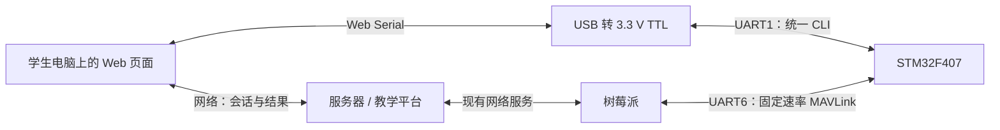

# UART1 CLI 与 UART6 实验通信总体设计

- 日期：2026-10-15
- 文档版本：R0.3，跨端评估稿
- 计划归属：V1.1 或 V1.2，具体发布版本待用户安排
- 目标读者：F407 固件、树莓派、服务器、Web 与产品设计人员

> 本文描述拟议能力，尚未实现、联调或验收。用户已认可 UART1 统一教学诊断 CLI 的方向，并明确将本改造放到后续 V1.1／V1.2 评估。本稿不改变 V1.0 的范围、候选身份、执行台账或验收结论；文中的参数和协议分配均需跨端评审后冻结。

配套文档：[教学诊断 CLI 与 UART6 跨端接口契约](V1.1-V1.2_教学诊断CLI与UART6跨端接口契约.md)。协议字段、命令和错误码以配套契约为唯一评估定义，本文说明目的、职责和取舍。

R0.3 修订：其他模块统一采用 get／set，补充查询目录、可写参数、取值范围、一次性动作、只读编译配置和代码来源；完整字典以配套契约第 11 章为准。CLI 均未实现，仍为 V1.1／V1.2 评估设计。

## 1. 改造目的与教学要求

现有实验一手册的主线为：复位、使能串口、基准回显、单端失配、调整伴随计算机参数、恢复验证、比较速率、恢复现场。学生主要通过 Web 按钮操作树莓派与 F407 之间的 UART6。

拟议改造让学生电脑通过 USB 转 3.3 V TTL 接入 UART1。浏览器按钮和手动终端共用同一套 CLI 命令，学生可直接观察实际请求、原始响应和设备诊断。常规实验继续通过树莓派和 UART6 完成；需要直接排障时再连接 UART1。

设计遵循以下要求：

1. 每项学生操作都有可观察的结果和可解释的原因，支持手动改参、失败观察和手动恢复。
2. 浏览器可以代学生生成命令，但必须显示实际发送内容；教学步骤由学生推进。
3. 电脑端参数和 F407 端参数分别设置。失配阶段保留电脑端原参数，等待学生主动修改。
4. 串口通信失败、设备运行状态、网络连接和实验进度分别记录。
5. 图形、历史、分析和长说明放在 Web／手册，屏幕保留参数、关键状态和必要操作。
6. F407 使用静态、有界的解析和缓存；采集、控制保护与显示实时性继续保留。

## 2. 已核对的当前基线

本稿依据当前仓库 HEAD `3a9ee21a8c5ea33231298e5030ff1942d667fe68` 及下列文件编写。该 HEAD 位于 SRAM／显示优化分支，不能当作已合入 develop 的发布基线。

| 当前事实 | 依据及边界 |
|---|---|
| UART1 为 USART1，PA9／PA10，默认 115200、8N1，供 DebugConsole 输出 | `Bsp/Inc/bsp_config.h`、`Bsp/Src/bsp_uart.c`；尚无本文 CLI 接收和命令分发 |
| UART6 为 USART6，PC6／PC7，默认 115200、8N1，经 3.3 V USB-TTL 连接树莓派 | BSP 配置；实际线束、树莓派串口节点和适配器仍需现场核对 |
| UART6 接收采用字节中断和 128 B 环形缓冲，发送为阻塞接口 | `bsp_uart.c`；本稿不把异步发送描述成现有能力 |
| H1 回显与 B1 改参承载于 UART6 MAVLink 2 TUNNEL 0x8003 | `px4lite_rpi_h1_echo.h`、`px4lite_rpi_baud_switch.h` |
| 现有 B1 只支持本启动周期内从 115200 切到 57600，先发旧速率接受响应，再重配；复位恢复默认 | 当前 B1 代码；与拟议 UART6 固定速率存在明确兼容冲突 |
| UART6 存在独立全量出口目录，周期项受 1000 ms 下限约束 | `Framework/Src/px4lite_mavlink_tx.c`；另有身份镜像等发送入口，过滤必须覆盖全部 UART6 出口 |
| 长期产品标识为 20 字符，Node ID／MAVLink sysid 为可配置短地址 | `Framework/Inc/px4lite_identity.h`；跨端绑定使用长期标识，短地址用于路由和课堂冲突实验 |
| 当前事件历史是固定环，主要保存消息编号与秒级 Uptime | `px4lite_local_msglog.h`；不能直接提供本文要求的毫秒级参数变更详情 |

输入手册文件名为《实验一串口通信实验手册 V0.1.pdf》，正文标为 V0.2。新版手册需要统一版本号和接线描述。本次只参考其教学流程，没有核验树莓派、服务器或 Web 源码。

## 3. 方案选择

| 方案 | 教学与工程特点 | 本稿建议 |
|---|---|---|
| Web 经树莓派，在 UART6 上完成回显和改参 | 沿用原连接；失配会中断同一条业务链路，需要额外处理会话与连接关系 | 保留为 V1.0 历史路径 |
| UART1 统一 CLI，学生电脑直连；UART6 管理和按需上报 | 学生能区分两端参数；实验链路失配时仍可观察设备；命令可用于其他实验诊断 | 推荐评估主方案 |
| UART1 分为独立诊断协议与串口实验协议 | 需要额外模式和两套识别、响应规则 | 本轮不采用 |

串口实验使用 CLI 内的 `echo`、`get uart_baud`、`set uart_baud = <value>`、`get uart_stats`，无需切换到另一套诊断／实验协议。设备级实验会话仍然存在，用于 UART6 的数据选择和平台记录。

## 4. 连接与各端职责

图中的网络服务表示职责关系，不指定现有项目使用 HTTP API、WebSocket 或其他服务框架。

| 参与端 | 拟承担职责 | 事实来源 |
|---|---|---|
| F407 | CLI、UART1 临时改参、设备配置和计数、UART6 数据筛选、设备操作事件；继续负责本机采集和保护 | 设备本机状态及真实处理结果 |
| 树莓派 | UART6 唯一进程所有者、能力握手、命令编解码、状态转发、接收时间和链路监控 | UART6 原始帧及树莓派本机时间 |
| 服务器 | 设备占用、课堂身份、会话与步骤、结果存储、网络鉴权、版本兼容 | 服务器记录；不代替设备确认 |
| Web | 本机 UART1 读写、命令终端与按钮、原始字节、可视化、手动步骤和记录 | 本机实际收发，以及经平台获取的设备状态 |
| 学生／教师 | 接线与选设备、分别改两端参数、观察失配、验证恢复、结束并释放设备 | 人工操作及对应证据 |

UART1 直连的设备长期标识必须与平台所选设备一致。发现不一致时，页面展示两个标识并阻止合并实验记录；学生重新选择设备。系统不通过修改 Node ID 来修复选错箱子。

## 5. UART1 统一教学诊断 CLI

### 5.1 首轮范围

候选命令统一为 `help`、`echo`、`get`、`set`。设备信息也使用 `get device_info`；查询与设置采用同一套名称，不为每个模块再增加独立命令动词：

| 学生输入 | 用途 |
|---|---|
| `get uart_baud` | 查询 F407 当前已应用的 UART1 波特率，单位 bps |
| `get device_info` | 查询长期身份、Node ID、固件版本和能力 |
| `set uart_baud = 57600` | 请求将 F407 的 UART1 临时改为 57600 bps |
| `get uart_data_bits`、`get uart_parity`、`get uart_stop_bits` | 分别查询数据位、校验和停止位；首轮固定为 8、N、1，只读 |
| `get uart_stats` | 查询本启动的串口收发、解析和错误计数 |
| `help set uart_baud` | 查看写法、允许值、运行期生效和复位恢复规则 |
| `echo "hello cns"` | 回送本次文本，用于真实往返测试 |

参数名均为小写 ASCII，以 `_` 分词；`uart_` 在本稿 CLI 中专指 UART1，UART6 保持固定管理配置。`set uart_baud=57600` 与带空格写法等价，浏览器统一生成表中的带空格写法。只写 `set uart_baud` 不改变参数，返回缺少值的错误和用法；查询使用 `get`。

其他模块的查询和设置见下表；名称、字段、单位、范围、持久化与代码依据详见配套契约第 11 章。表中“已有”只表示数据或业务接口已有，不能理解为 CLI 已实现。新增 CLI 接入与所需的少量 App 快照／命令桥接仍需排期；不会自动把全部候选纳入首发。

| 模块 | 候选 get 查询 | 候选 set 参数／动作 | 主要取值范围与边界 |
|---|---|---|---|
| 身份／系统／时间 | device_info、node_config、system_status、module_status、time_utc、time_sync | node_id、node_action | Node ID 1—250；追加保存后重启生效；长期身份、时间和模块状态只读 |
| GNSS | gnss_position、gnss_velocity、gnss_quality、gnss_time、gnss_link | 无运行期写项 | 经纬度用 1e-7 度，高度 mm，速度 cm/s；各域独立判新 |
| IMU／姿态 | imu_accel、imu_gyro、imu_temperature_cdeg、attitude、attitude_rates、attitude_status | attitude_action | bias_calibrate／zero／restore；显示归零不改控制与日志的测量值 |
| 环境／双路电源 | baro_pressure_pa、baro_temperature_cdeg、baro_humidity_pct100、power1、power2、baro_motion | 无直接写测量值 | 气压有效性判据 30000—110000 Pa，湿度 0—100%；电流需独立有效位；气压运动量需补 App 视图 |
| LoRa | lora_config、lora_lab、lora_rx_stats、lora_tx_stats | lora_channel、lora_data、lora_interval_ms、lora_action | CH 23／26／29／32；数据组四选一；间隔 1000／2000／5000／10000 ms；信道写 E22 并读回 |
| 远端观察 | remote_node、remote_node_status、remote_gnss、remote_attitude、remote_power1、remote_power2、remote_environment | remote_node | 一个已发现、非本机、无地址冲突的对端；只选择本地观察对象，不改远端设备 |
| 电机／控制 | motor_status、motor1_target_pct—motor4_target_pct、motor1_output_pct—motor4_output_pct、motor1_pwm_us—motor4_pwm_us | motor_mode、四路 target_pct、motor_action；精确 PWM／目标角列为需补 App 接口的候选 | 目标油门 0—100%；PWM 1000—2000 us；横滚／俯仰目标 ±4500 cdeg，偏航目标 ±18000 cdeg；保留现有控制门禁 |
| 两路观察 | observe_status、observe_stats、observe_point、observe_field | observe_field1、observe_field2、observe_interval_ms、observe_frozen、observe_action | 字段 0—37；间隔 200／500／1000 ms；最多 64 点；Freeze 仅冻结绘图 |
| CSV／SD | record_status、record_counts、sd_status | record_interval_ms、record_action | 1000／2000／5000／10000 ms；start／stop；Stop 后需等队列处理和同步结果 |
| 原始报文／NMEA | capture_status、capture_errors、capture_summary、capture_frame、capture_nmea | capture_source、capture_filter、capture_action | 五选一入口，NMEA 五种筛选；4 槽、16 汇总键；原始字节每次最多 64 B |
| 资源／显示 | resources_heap、resources_imu、resources_comm、resources_display、resources_lvgl、task_runtime | 无运行期写项 | 内存 B、耗时 us／ms、栈 word 明确区分；不把堆占用当成整片 SRAM 占用 |
| 告警／本机日志 | alarm_summary、alarm_entry、log_status、log_entry | 无清除故障或清历史入口 | 最多 14 模块告警位、32 条本机历史；每次一条，保留版本和序号 |
| 5G／RemoteID | module_status module=cellular／remote_id、remoteid_tx | 无网络 AT 或广播配置写项 | 5G／业务串口／网络分开；RemoteID 提交统计需补所有者快照，不冒称空口已收到 |
| 实验管理 | experiment_status、experiment_profile、operation_status | UART1 不提供会话 START／END 写入口 | UART6 原有候选会话控制保留强类型操作，防止本机文本绕过平台会话 |

动作同样使用 set，例如 `set attitude_action = zero`、`set lora_action = send_once`、`set record_action = start`。动作是一次性请求，按请求号关联真实完成结果；它不是写入一个长期参数。普通赋值不附带启动实验、连续发送或记录的动作。

大对象使用明确选择器读取，例如 `get task_runtime index=0`、`get capture_frame session=3 token=12 offset=0 length=64`。仍保持 128 B 请求／512 B 单行响应，不提供全量 dump、模糊匹配或自动连续输出。参数元数据通过 `help get <name>`／`help set <name>` 按项查询。

CLI 仅连接字典列出的业务白名单，不提供通用 Shell、脚本、任意内存或任意外设寄存器写入。电机、Node ID 保存和 LoRa 信道操作复用既有业务服务、门禁与操作记录；编译参数保持只读。新增接口不得绕过 App API 或由通信解析器直接驱动硬件。

### 5.2 人工与浏览器共用

- 人工可输入 `echo "hello cns"`；浏览器使用带请求号的同义命令，关联迟到和重复响应。
- 按钮执行前后显示实际 TX／RX。界面本地输入回显不计为设备响应。
- 设备不主动发送提示符、逐字输入回显或周期调试文本。启动／异常事实继续进入设备日志和相应管理路径；CLI 按需读取。
- 接收端按行组帧，浏览器必须处理拆行、粘行和 UTF-8 跨读取分块。
- 正常操作一次只有一条 CLI 请求在途；超时后先恢复行边界，再开始下一次操作。

### 5.3 改参和恢复

`set uart_baud = 57600` 只修改 UART1 的本次运行配置。设备在旧速率完整发出 `ACCEPTED` 响应，确认物理发送完成后再应用新速率；切换时处理旧输入残留，不能把半条旧命令拼接到新速率请求。

接受响应只证明事务已受理。学生手动修改电脑参数后，发送新的 `get uart_baud` 和 `echo`；UART6 旁路状态也可确认设备配置和失败原因。

UART1 首轮只开放 115200／57600、8N1。复位后 UART1 回到 115200，不写 Flash，不自动扫描或匹配电脑波特率。屏幕或 UART6 可提供明确的手动恢复入口，共用同一 UART1 参数服务；常规实验步骤仍优先让学生直接使用 CLI。Node ID 与 E22 信道的持久化行为分别按参数字典处理，不能套用 UART1 的临时配置规则。

## 6. UART6 正常观察与按需实验

UART6 在新协议固件中固定为 115200、8N1。实验状态仅影响该端口的发送目录和元数据；传感器采集、估计、LoRa、RemoteID 独立物理出口、本机告警与控制保护照常执行。

HELLO、状态查询和必要管理响应以物理 UART6 可用为前提，不要求 5G／服务器网络、LoRa 或动力供电先在线。既有网络状态判定与新的实验保活分别维护，避免管理链路依赖尚待其建立的网络状态。

### 6.1 三种设备发送状态

| 状态 | 含义 | UART6 发送行为 |
|---|---|---|
| `NORMAL` | 无活动实验 | 沿用已启用的日常遥测及当前既有在线规则；“全量”指已配置出口，不代表全部原始采样 |
| `ACTIVE` | 已接受一个明确实验请求 | 发送最小管理集、选中实验数据和操作事件，关闭无关周期目录 |
| `HOLD` | 实验暂停或保活超时 | 保留会话标识与最小管理集，暂停实验周期数据，等待人工继续或结束 |

最小管理集建议包含 HEARTBEAT、SYS_STATUS、模块状态、原告警表、会话状态、控制响应和操作事件。完整周期日志表与非必要身份镜像在实验期间暂停；长期身份通过握手查询。完整历史由服务器保存，本机限量历史查询作为后续扩展评估。具体目录映射见接口契约。

`NORMAL → ACTIVE` 由明确开始请求触发；正常结束后 `ACTIVE/HOLD → NORMAL`。页面刷新、波特率失配或网络恢复均不自动执行这些状态切换。

保活用于确认实验控制链路仍存活，可以后台执行。树莓派不能只因 UART6 仍连接，就在服务器控制连接已经失效时持续替失效会话保活。超时进入 HOLD，不自动恢复全量遥测或重新启动实验。

### 6.2 数据与负载

建议采用一个活动实验、固定数据组位图、一个公共周期，首轮最多选择两组。候选周期为 200—5000 ms；200 ms 仅为申请下限，设备按完整帧字节预算和任务耗时判断能否接受，拒绝时返回原因，不静默降低速率。

周期数据复用既有 MAVLink 编码和字段，避免再维护完整传感器协议。新能力仅公布已完成映射的组；原始 IMU 高速流、原始 NMEA、任意消息订阅和全量历史同步不随组名自动开放。

过滤应在编码前按内部目录项／字段 name 执行，覆盖常规目录、RPi 专属目录和独立镜像入口。不能仅按 MAVLink message id 筛选：多个数据项共用 NAMED_VALUE_INT 或 TUNNEL。

实验配置更改和继续均使用明确请求。结束不代表电机动作已经撤收、CSV 已经同步完成或 LoRa 在途帧已被撤回；涉及此类实验时沿用对应业务的终态确认，完成后再恢复 NORMAL 并释放设备。

## 7. 状态、时间与记录

### 7.1 分开显示的状态

Web 至少区分：平台网络连接、树莓派在线、UART6 管理可达、浏览器 UART1 是否打开、最近 CLI 验证结果、设备实验状态、课堂步骤。

浏览器打开串口不代表 F407 已响应；波特率失配不代表设备掉电。设备报告的 UART 配置也不是对电气实际波特率的仪器测量。

### 7.2 会话与启动边界

- 平台保存课程步骤和结果；F407 仅保存当前实验的有界运行状态。
- `session_id` 标识一次实验，`boot_token` 标识一次经 UART6 握手绑定的启动，`request_id` 标识一次请求。
- 为避免新增 F407 随机源依赖，候选方案由树莓派在首次 HELLO 时提供非零随机 boot_token，F407 在本次启动固定保存。未绑定前为 0，CLI 仍可离线查询和回显。
- boot_token 为 0 的离线诊断按本地连接／人工复位分段，不承诺自动识别所有复位；上传后不能自动拼入旧在线启动记录。
- F407 复位会清除实验运行状态和临时 UART1 参数；平台保留步骤，显示“设备已重启，待确认”，由学生明确重新进入适当状态。

该 boot_token 方案是评估建议，树莓派／服务器需确认首次握手、重复握手和离线记录的管理方式。

### 7.3 时间与证据

F407 使用启动毫秒；浏览器和树莓派分别使用各自单调时钟测量。不同端的时间不能直接相减。浏览器 RTT 包含 USB、驱动、缓冲、解析与调度，不能当作实际线路上的纯发送时间。

理论串行时间使用完整命令与完整响应的线上字节数，包括前缀、引号、转义和 CRLF。位帧动画标为示意，电气波形需要外部仪器。

设备操作事件记录来源、请求号、阶段、参数和设备时间。ACCEPTED、APPLIED、FAILED 各有明确含义。事件采用固定环并报告丢失计数；原消息历史仍保留其用途，不把秒级文本日志强行解释为精确的参数事务记录。

## 8. 分层与资源约束

| 层级 | 拟议职责 |
|---|---|
| BSP | UART1 初始化、接收缓冲、原始发送、错误计数、改参和中断；不解析命令 |
| Platform Adapter | 封装 UART1／UART6 的平台能力与类型转换 |
| Framework 通信服务 | CLI 行解析、通信类命令、UART 参数事务、UART6 实验配置与发送筛选、固定邮箱 |
| Business | 经固定邮箱消费业务查询／操作；使用 app_data_api.h 和既有 App_Request 入口；负责屏幕与本机业务交互 |
| 树莓派／Web／服务器 | 协议适配、历史、图形、课程步骤和记录；不远程接管传感器采集任务 |

echo 和 UART 参数事务由通信资源所有者处理，避免绕到 200 ms 业务采集周期后再响应。业务快照查询可以由既有业务任务处理，需在能力与超时说明中公布。

首轮建议验收预算：

- 不新增 FreeRTOS 任务，不在启动后分配堆内存；所有队列、文本和响应有固定上限。
- 新增主 SRAM 目标不超过 4 KiB，Flash 目标不超过 24 KiB；均为设计上限，尚无实现测量。
- 集成后的静态主 SRAM 空余目标至少 12 KiB，heap_4 峰值低于 75%，任务栈和调度另做运行验收。
- 当前优化分支 MAP 为主 SRAM 空余 19384 B；已发布 M5 基线曾仅余 4616 B。必须先选择并验证合适集成基线，不能直接把优化分支容量当作已发布版本余量。
- UART1 响应采用有界、非阻塞发送服务，不能一次长字符串阻塞 CommTask。具体 IT／DMA 路由在后续实施设计冻结，DMA 缓冲继续位于主 SRAM。
- UART6 仍需计算现有阻塞发送最坏耗时；缩减目录不能代替资源与并发实测。控制／告警优先，周期实验流受预算限制。

参考资源证据：优化分支 `codex/opt-sram-display-refresh`、提交 `3a9ee21a8c5ea33231298e5030ff1942d667fe68` 中的 `Development_Guide/2026-10-15_SRAM与显示刷新精简说明.md`。该说明尚未随本文合入 develop；优化分支的资源数据不证明本文新功能的资源占用或稳定性。

## 9. 旧版本兼容与发布边界

1. V1.0 原协议、手册和候选保持原适用范围。本稿不是 V1.0 补丁，也不追溯修改已有验收记录。
2. 新旧能力通过 UART6 HELLO／UART1 `get device_info` 查询，逐项名称再以 help 检查；不能仅凭固件版本字符串或串口能打开判定。
3. 新固件建议保留 UART6 H1 作为管理链路诊断；新串口实验使用 UART1 CLI。H1 结果不能代填 UART1 的回显证据。
4. 新固件默认关闭旧 UART6 B1 改参能力。旧 B1 与“UART6 固定速率”不能同时承诺；旧平台在发 B1 前必须核验能力，不支持时明确拒绝该旧课程流程。
5. 旧固件配新平台：可展示原遥测，CLI／按需会话入口标为不支持；是否继续运行旧实验由平台保留独立课程版本。
6. 新固件配旧平台：正常遥测尽量保留现有编码；旧 B1 属于有意变化，需升级平台或保留旧固件，不能假定完全兼容。
7. 具体落在 V1.1 或 V1.2，以及是否分批发布 CLI 和按需上报，由联合评审结果决定。本稿不承诺发布日期。

## 10. Web 接入条件

浏览器通过 Web Serial 访问学生电脑上的串口，不直接访问远端树莓派的串口。推荐课堂以受支持的桌面浏览器、可信 HTTPS 入口运行；平台可以用 HTTPS 反向代理衔接原 HTTP 后端，同时处理接口与 WebSocket 的访问。

当前平台只有 HTTP。开发联调可在受控测试电脑上对指定 origin 配置 Chromium 的安全上下文测试例外；这是环境准备项，需要逐台确认，不作为面向学生的标准实验步骤。localhost 例外指学生电脑本机，不包括树莓派局域网 IP。

若实验页嵌入 iframe，需要同时核对祖先页面的安全上下文和 serial Permissions Policy；只把子页换成 HTTPS 不足以解决 HTTP 父页面的问题。具体部署由服务器／Web 侧评估。

## 11. 各端评估清单

| 编号 | 评估责任 | 本稿建议／需要反馈的内容 |
|---|---|---|
| A01 | 产品／教学 | 统一 CLI、按钮与手动终端并存；首轮实验保留 8N1 和两档波特率 |
| A02 | 硬件／固件 | UART1 是否已方便引出 TX／RX／GND，现有适配器电平、线束和标识是否适合课堂 |
| A03 | 树莓派 | UART6 单一进程所有权、串口设备稳定识别、能力握手、boot_token 绑定及旧 B1 禁用适配 |
| A04 | 服务器 | 单活动实验、设备占用、页面刷新恢复、断连暂停、结束与设备释放、记录去重 |
| A05 | Web／服务器 | HTTPS 入口、串口授权、iframe 条件、学生电脑浏览器与驱动部署 |
| A06 | 三端协议人员 | 新 TUNNEL 类型／opcode 是否冲突，所选数据组、公共周期、错误与事件枚举是否足够 |
| A07 | 三端协议人员 | 首轮两组与 200—5000 ms 申请范围；组内流量和最小管理集是否满足课程 |
| A08 | 固件／树莓派 | HOLD、保活超时和人工继续是否适合现有连接机制，断网时的实验终止与业务保护如何衔接 |
| A09 | 产品／固件 | 配套参数字典的 get／set 范围、需补 App 接口项、屏幕手动恢复入口，以及 V1.1／V1.2 分批发布边界 |
| A10 | 测试／交付 | 同候选的协议、异常输入、真实收发、双口并发、资源、保护和课堂验收范围 |

建议各端按编号反馈“接受／建议修改／无法支持＋原因＋所需前置条件”。目前没有任何一项被记为已实现或验收通过。

## 12. 后续文档与证据

两份评估稿共同评审后，再编写实施与联调计划、新版实验一手册和联合验收增量。正式 Word 输出继续交由文档输出代理，主代理提供内部 Markdown 技术事实。

本次只编写设计文档，未修改固件、Keil 工程或外设配置，未运行 Keil build，也未执行串口／实板测试。

## 13. 资料来源

- 当前仓库：`Bsp/Inc/bsp_config.h`、`Bsp/Src/bsp_uart.c`、`Framework/Inc/px4lite_rpi_h1_echo.h`、`Framework/Inc/px4lite_rpi_baud_switch.h`、`Framework/Inc/px4lite_identity.h`、`Framework/Inc/px4lite_local_msglog.h`、`Framework/Src/px4lite_mavlink_tx.c`。
- [原 UART6 H1 技术文档](阶段一_H1_UART6受控回显箱子端技术文档.md)、[原 B1 变更记录](Change_History/2026-09-24_01_阶段一M1_UART6受控波特率切换.md)：历史方案，当前行为仍以代码为准。
- [Betaflight CLI 官方文档](https://betaflight.com/docs/wiki/guides/current/Cli)：借鉴参数查询 `get` 与赋值 `set name=value` 的命令习惯；本文的参数名、响应、事务和生效规则由 CNS 契约定义。
- 用户提供的《实验一串口通信实验手册 V0.1.pdf》（正文 V0.2）：仅作为原教学流程输入。
- [Web Serial 标准](https://serial.spec.whatwg.org/)及[Chrome 使用文档](https://developer.chrome.com/docs/capabilities/serial)：本机串口授权、读写流与连接管理。
- [Secure Contexts 规范](https://w3c.github.io/webappsec-secure-contexts/)：安全上下文、回环地址与祖先页面规则。
- [Chromium 开发测试说明](https://www.chromium.org/Home/chromium-security/deprecating-powerful-features-on-insecure-origins/)：指定 HTTP origin 的开发测试例外。
