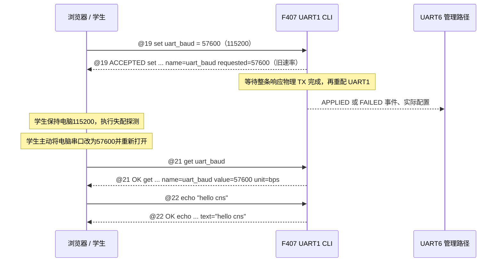

# 教学诊断 CLI 与 UART6 跨端接口契约

- 日期：2026-10-15
- 文档版本：R0.3，候选契约／跨端评估稿
- 计划归属：V1.1 或 V1.2，待联合评审和用户排期
- 目标读者：F407 固件、树莓派、服务器与 Web 开发人员

> 本文全部新增接口均未实现、未冻结、未实测。字段、数值和示例用于评估开发范围；示例数据不是抓包证据。新 TUNNEL 类型和 opcode 仅为本稿提议，不能据此向现有固件发包或宣称跨端兼容。

总体目的、分层和发布边界见[总体设计](V1.1-V1.2_UART1_CLI与UART6实验通信总体设计.md)。本文集中定义命令、字段语义、状态、时序与候选字节布局。

R0.3 修订：按用户意见，为其他模块补充统一 get／set 字典（第 11 章），记录可查询数据、可写参数、动作、范围、持久化和代码来源。设备信息改为 `get device_info`；大对象使用有界选择器；补充异步动作、保存待重启和候选事件字典。全部 CLI 均未实现，新目录不代表已经冻结的首发范围。R0.1／R0.2 旧草案写法不定义兼容别名。

## 1. 端口与协议边界

| 通道 | 候选配置 | 角色 |
|---|---|---|
| UART1 | 上电 115200、8N1；运行期可临时改为 57600 | 学生电脑直连，统一 UTF-8 行式 CLI |
| UART6 | 固定 115200、8N1 | 树莓派管理，MAVLink 2，普通遥测与按需实验 |
| Web—服务器—树莓派 | 沿用现有网络服务，由平台方适配 | 会话、命令请求、结果和记录；本文提供逻辑对象，不指定 URL |

UART1 和 UART6 共用参数及业务状态，只有资源所有者执行实际变更。CLI 不承载任意 MAVLink 注入；UART6 新协议也不提供任意 CLI 文本执行入口。

V1.0 的 UART6 H1/B1 继续属于原版本。本候选新固件保留 H1 管理诊断、禁用旧 B1 改 UART6；新平台必须按能力选择课程版本。

## 2. 共同约定

### 2.1 身份、时间与编号

| 字段 | 定义 |
|---|---|
| `product_id` | 当前设备的 20 字符长期标识；示例 `DCDWCNS10123456789AB`。来自固件身份接口，不由 Web 输入替代 |
| `node_id` | 1—250 的当前短地址／MAVLink sysid；用于路由，不能作为设备唯一标识 |
| `session_id` | 服务器生成的非零 u64 随机会话标识；0 表示无实验；网络 JSON 用 16 位十六进制字符串 |
| `boot_token` | 树莓派首次 HELLO 提供、F407 本启动固定保存的非零 u64；上电未绑定为 0；不是认证凭据 |
| `request_id` | 一个请求的 u32 编号；机器请求取 1—4294967295；CLI 手动无编号时为 0 |
| `device_uptime_ms` | F407 启动毫秒，u32；按模差处理约 49.7 天回绕，并结合 boot_token 区分启动 |
| `profile_generation` | 本启动内发送配置边界编号，u32；每次真正改变 NORMAL／ACTIVE／HOLD 或实验数据配置时增加 |
| `event_seq` | 本启动内事件序号，u32，从 1 开始自然回绕；记录键为 product_id＋boot_token＋event_seq |

序号回绕使用 u32 模差，不用普通大小比较跨越回绕点。服务器长期记录增加自身 UUID／时间，不把设备序号当作全局唯一编号。

浏览器与树莓派各自保存单调时钟和 UTC 记录时间。设备时间、浏览器时间、树莓派时间和服务器时间必须分字段保存；没有时钟同步证据时不跨端相减。

### 2.2 阶段定义

| 阶段 | 含义 |
|---|---|
| `SUBMITTED` | Web／树莓派已提交请求；不证明到达 F407 |
| `ACCEPTED` | F407 已接受事务，尚未确认实际配置完成 |
| `APPLIED` | F407 对应所有者已完成配置／状态切换 |
| `SAVED` | 仅适用于 Node ID：保存和读回完成，当前启动地址未改变，学生重启后另行验证 |
| `VERIFIED` | 上位机已取得新的匹配响应或规定的独立验证证据；不是 F407 提前返回的成功枚举 |
| `FAILED` | 指定阶段实际失败，并提供原因 |
| `TIMEOUT` | 上位机等待期限内未取得有效匹配响应；不能据此断言设备完全未处理请求 |

### 2.3 候选错误码

同一含义在 CLI 使用名称，在 UART6 使用下表数值。成功 status 为 0；错误不伪装成 OK。

| 值 | 名称 | 含义 |
|---:|---|---|
| 0 | OK | 请求规定的处理阶段成功 |
| 1 | E_UNSUPPORTED | 命令、opcode、能力或协议版本不支持 |
| 2 | E_ARG | 参数或范围非法 |
| 3 | E_LENGTH | 行／载荷长度非法 |
| 4 | E_BUSY | 响应槽、参数事务或其他必要资源忙 |
| 5 | E_STATE | 当前状态不允许该操作 |
| 6 | E_SESSION | 会话标识不匹配，或已有其他活动会话 |
| 7 | E_BOOT | 请求引用的启动与当前启动不一致 |
| 8 | E_CONFLICT | 相同请求号对应不同内容 |
| 9 | E_RATE | 请求／响应速率超过上限 |
| 10 | E_RESOURCE | 固定队列或缓存不足 |
| 11 | E_APPLY | 硬件配置或状态应用失败 |
| 12 | E_BUDGET | 所选周期／数据组超过通信或调度预算 |
| 13 | E_STALE | 读取的数据已过期，或控制上下文已经失效 |
| 14 | E_IDENTITY | 设备绑定不匹配；可由平台产生 |
| 15 | E_TX | 对应发送事务失败 |
| 16 | E_NOT_READY | 设备／必要服务尚未就绪 |
| 17 | E_ENCODING | UTF-8、引号或转义非法 |

无法信任目标、请求号或载荷边界的坏帧只增加计数，不能用猜测字段回复。错误风暴需要限速并保留错误计数。

## 3. UART1 CLI

### 3.1 字节流、行边界与长度

1. UTF-8 编码，不带 BOM。发送推荐 CRLF；接收允许 LF 或 CRLF，单独 CR 不能提交命令。
2. 一行最多 128 B，不含结尾 CRLF；F407 预留终止字符。响应总长最多 512 B，包含 CRLF。
3. 首轮接收环建议 256 B、响应槽 1 个，具体容量由实施资源预算核定。超长行丢弃到下一个 LF，仅产生一次 E_LENGTH。
4. 没有提示符、自动逐字回显、ANSI 控制序列或设备侧命令历史。终端输入框可在电脑上编辑，提交后一次发送完整行。
5. 控制字符只允许作为行结束的 CR／LF；正文不允许 NUL、TAB、退格、ESC 和其他控制字符。
6. 半行在 1000 ms 内未继续收到字节时丢弃并计数；串口重配清空半行和未提交旧输入。
7. 浏览器先保留原始字节，再进行流式 UTF-8 解码和按行解析，不能把一次 read() 当作一个响应。
8. 一次只等待一条行响应；ACCEPTED 后可串行查询状态，但原控制事务仍占用普通控制槽，不能并发提交另一个普通 set。急停／撤收请求按 3.6 节处理。候选上限 5 条／秒、UART1 响应字节预算 2048 B／秒，超限按 E_RATE 处理。这些是待实测的上限建议。

### 3.2 请求语法

```text
[ @<request_id> SP ] help [ SP <command> [ SP <name> ] ] <EOL>
[ @<request_id> SP ] echo SP "<text>" <EOL>
[ @<request_id> SP ] get SP <name> [ SP <selector>=<value> ... ] <EOL>
[ @<request_id> SP ] set SP <name> [SP] = [SP] <value> <EOL>
```

上式方括号表示可选，不实际发送；EOL 为 LF 或 CRLF。SP 表示一个或多个 ASCII 空格，等号两边的空格可省略。命令和参数名使用小写 ASCII；参数名匹配 `[a-z][a-z0-9_]{0,30}`，最多 31 字符，按完整名称精确匹配。request_id 使用十进制，无符号；人工省略前缀等同于 request_id=0。

`get` 只查询；`set` 必须带等号和一个合法值。值的类型由第 11 章逐项定义：u32 使用无符号十进制；i32 允许一个前导负号（不接受正号）；bool 使用 0／1；enum 使用表列小写 ASCII 名称。整数除数值 0 外不使用前导零，不接受单位后缀、浮点输入、表达式或隐式换算。只写 `set uart_baud` 或 `set uart_baud =` 返回 E_ARG 和用法，不修改配置。

选择器只用于字典明确列出的大对象；最多 5 个，名称不重复，值必须精确合法。module／item 使用白名单枚举；channel／index／session／token／version／offset／length 使用无符号十进制。不得给普通标量查询附加选择器。多余、遗漏必需、重复或未知选择器返回 E_ARG。它们与外层 request_id、服务器 session_id 含义不同，详见第 11 章。

`set uart_baud=57600`、`set uart_baud =57600`、`set uart_baud= 57600` 和 `set uart_baud = 57600` 含义相同。浏览器按钮统一生成最后一种写法。首轮不支持空参数 `get`／`set`、部分名称搜索、通配符、多条命令、行内注释或批处理。

```text
help
help set uart_baud
get device_info
echo "hello cns"
get uart_baud
set uart_baud = 57600
get uart_stats
get gnss_position
set lora_channel = 26
get task_runtime index=0
@17 echo "hello cns"
@18 get uart_baud
@19 set uart_baud = 57600
```

上面各行是独立语法示例，不是自动连续执行脚本；波特率切换后的操作必须遵守 3.7 节的人工改参和验证时序。

echo 文本必须放在英文双引号内。仅支持 `\"` 和 `\\` 两种转义，分别表示双引号与反斜线；不支持 `\n`、`\xNN` 或通用脚本转义。解转义后为 1—48 B 合法 UTF-8，不能含控制字符，纯 ASCII 空格拒绝；不做 Unicode 归一化或重编码。

### 3.3 响应语法

```text
@<request_id> <OK|ACCEPTED|ERR> <command_key> boot=<16位大写HEX> uptime_ms=<u32十进制> <fields...> CRLF
```

- command_key 使用 `help`、`echo`、`get`、`set`，不含空格；参数查询和赋值额外返回 `name=<参数名>`。机器请求同时核对 request_id、command_key、已知 name 和选择器，不能把另一参数或槽位的响应当作成功。
- 字段采用 ASCII `key=value`。数值、参数名和 ASCII 枚举标识不加引号；位图使用 `0x` 前缀；文本字符串使用英文双引号，转义规则同请求。
- 只读浮点派生量使用有限十进制，按字段元数据公布小数位数，最多 6 位；禁止 NaN／Infinity。小数位数仅为序列化分辨率，不表示传感器精度。无法在单行预算内完整表达的值须报 E_LENGTH，不能静默截断。
- `get` 的标量成功响应返回 `name`、`value`，有物理单位时返回 `unit`。`get uart_stats` 为固定字段快照，直接返回计数，不伪装为可写标量。读取配置失败时返回 E_NOT_READY，不用请求值代填实际值。
- 普通 `set` 需要后续应用时返回 ACCEPTED，包含 `name`、`requested`；可靠旧值存在时带 `old_value`。目标值不使用 `value` 字段冒充实际值。已确认无需执行的普通赋值可返回 OK、`value=<实际值>`、`changed=0`；动作项不能用“值相同”跳过执行。
- UART1 改波特率保留 3.7 节的特殊时序；其他异步操作只回一条 ACCEPTED，再用 `get operation_status` 和相应模块状态按需查询终态，不在 UART1 自动插入异步文本。Node ID 终态区分 SAVED 与当前启动生效。具体关联规则见 11.1／11.9 节。
- 不把随机日志、自然语言句子或输入框本地回显混入响应。
- 所有响应包含 boot 和 uptime_ms；boot=0 表示 UART6 尚未建立启动绑定。
- 机器请求按 request_id 匹配；未知或过期 request_id 作为原始接收保留，不能结束另一个在途请求。
- 人工无编号响应使用 @0。收到行响应后可串行 get 查询控制终态，终态前不提交其他普通 set；没有请求号时尤其不能用迟到响应匹配新操作。

拟议示例：

```text
@17 OK echo boot=89ABCDEF01234567 uptime_ms=12000 text="hello cns"
@18 OK get boot=89ABCDEF01234567 uptime_ms=12100 name=uart_baud value=115200 unit=bps
@19 ACCEPTED set boot=89ABCDEF01234567 uptime_ms=12200 name=uart_baud old_value=115200 requested=57600 unit=bps
@20 ERR set boot=89ABCDEF01234567 uptime_ms=12300 name=uart_baud code=E_ARG usage="set uart_baud = <value>"
@21 OK get boot=89ABCDEF01234567 uptime_ms=12400 name=uart_baud value=57600 unit=bps
```

示例展示省略了行末 CRLF。ACCEPTED 只用于实际需要后续应用的事务。

### 3.4 核心命令

| 编号 | 命令 | 必需响应字段／行为 |
|---|---|---|
| C01 | `help`、`help <command>`、`help get <name>`、`help set <name>` | `commands="help echo get set"` 或 `usage="..."`；已知参数的帮助同时返回名称、类型、访问权限、允许值和生效方式，见 3.5 节；单行有界 |
| C02 | `get device_info` | `name=device_info`、`product_id`、`node_id`、`fw`、`cli="1.0"`、`dictionary="0.3"`、`caps`；通用 boot／uptime_ms 仍保留 |
| C03 | `echo "<text>"` | `text="<原文本字节>"`；只回送本次收到的合法内容，不写死默认文本 |
| C04 | `get uart_baud`；其他配置名称见 3.5 节 | `name`、`value`；波特率附 `unit=bps`，表示本机成功应用的 UART1 配置 |
| C05 | `set uart_baud = <value>` | 允许 115200／57600；有变化时返回 ACCEPTED；无变化时 OK 且 `changed=0`；复位恢复 115200，不写 Flash |
| C06 | `get uart_stats` | `name=uart_stats`、`rx_bytes`、`valid_cmd`、`parse_error`、`rx_drop`、`uart_error`、`response_tx_done`、`tx_error`、`partial_drop`、`baud` |

诊断计数全部为本启动累计 u32，按模差计算本阶段增量。rx_bytes 指软件实际接收到的字节；response_tx_done 只在整条响应物理发送完成后增加，包含所有 CLI 响应，不专指 echo。浏览器的 echo 成功数另按请求匹配统计。

读取 `get uart_stats` 时，本次请求已计入 rx_bytes／valid_cmd；其自身响应尚未计入 response_tx_done。UI 必须说明统计边界，不能把多个计数的差简单解释为丢包数。

扩展 C07：第 11 章列出各模块完整候选字典，用有界 `get` 查询和白名单 `set` 接入已有业务。与基础串口实验命令分开评估排期；带“需补 App”标记的项必须先补正式边界与回执，不能直接访问 topic／BSP。基础 `get device_info`／`get uart_baud`／`get uart_stats` 不依赖可选 GET_SNAPSHOT；扩展查询还需逐名称 help 确认，不能凭粗粒度能力位推断全部字典均受支持。

### 3.5 UART 基础参数与帮助

| 名称 | 类型／单位 | 权限 | 允许值／复位值 | 生效与响应边界 |
|---|---|---|---|---|
| `uart_baud` | u32，bps | rw | 115200 或 57600；复位值 115200 | UART1 运行期配置；经过旧速率响应发送完成再应用，不保存 Flash |
| `uart_data_bits` | u8，bit | ro | 固定 8 | 返回当前已应用数据位；不开放写入 |
| `uart_parity` | enum | ro | 固定 N | N 表示无校验；不开放写入 |
| `uart_stop_bits` | u8，bit | ro | 固定 1 | 返回当前已应用停止位；不开放写入 |
| `uart_stats` | 固定字段快照 | ro | 本启动累计计数；当前 baud | 不支持 set、清零或保存；字段含义见 C06 |

`uart_` 在本稿 CLI 中明确指 UART1，不表示 UART6 或学生电脑串口。`get` 不修改设备；修改 F407 的 uart_baud 也不会同步修改电脑端配置。查询值由资源所有者的已应用配置取得，不能从最近请求值推断。

未知或本固件未支持的名称返回 E_UNSUPPORTED；对已知只读名称执行 `set` 返回 E_ARG、`detail=read_only`；对只写动作项执行 `get` 返回 E_ARG、`detail=write_only` 并指向状态查询名。缺值、多值、非法范围或多余参数返回 E_ARG。错误不触发任何配置变更。`help set <只读名称>` 可返回该名称的 `access=ro` 和读取用法，帮助查询本身不执行写操作。

`help get <name>`／`help set <name>` 返回通用 boot／uptime_ms，以及 `name`、`usage`、`type`、`access`；标量带 `allowed`，有确定复位值时带 `default`，物理量带 `unit`，可写参数带 `storage` 和 `apply`。动作使用 `access=wo`、`type=action`、`apply=owner_action` 和对应 `status` 查询名，不编造默认动作。统计快照返回 `type=snapshot`，不编造标量范围或默认值。help 必须按该固件已接入的白名单返回，不能照抄评估文档冒称支持。

```text
@30 OK help boot=89ABCDEF01234567 uptime_ms=13000 name=uart_baud usage="set uart_baud = <value>" type=u32 unit=bps access=rw allowed="115200,57600" default=115200 storage=volatile apply=after_tx_complete
@31 ERR set boot=89ABCDEF01234567 uptime_ms=13100 name=uart_parity code=E_ARG detail=read_only
@32 OK get boot=89ABCDEF01234567 uptime_ms=13200 name=uart_data_bits value=8 unit=bit
```

`set` 请求通过统一白名单进入对应所有者的参数／动作服务。UART1 参数仍走既有候选 UART1 事务；其他模块按第 11 章接入。后续新增参数也必须逐项登记权限、类型、单位、范围、应用条件、持久化和事件语义。

### 3.6 请求去重与失败恢复

- echo 和只读查询每次合法提交都实际处理，便于真实往返测试；浏览器使用新的 request_id。
- 控制事务保留本端最近一个带编号请求的规范化内容和结果。相同编号、相同内容返回已有阶段；相同编号、不同内容返回 E_CONFLICT。
- `set` 以命令、完整参数名和解析后的类型值作规范化内容，等号两边空格不影响去重；echo 内容仍保留原始文本字节，不做这种改写。
- 缓存只保证最近事务，不提供任意历史的 exactly-once。浏览器在超时后先查询设备状态，不盲目重发改参命令。
- UART1 共用一个有界控制事务槽，串口改参、模块赋值和动作均经该槽跟踪；它只序列化 CLI 在途控制，不能绕过各资源的既有维护锁和请求槽。冲突返回 E_BUSY，不覆盖待处理事务；只读状态查询继续允许。
- 控制槽不得阻断现有急停／撤收语义。motor_action=estop、lora_action=stop 等优先请求的覆盖条件、固定关联槽及旧事务终态须在实施前冻结；不能为了串行化而让电机急停等待普通事务完成，也不能把旧事务静默标成成功。此项属于 P09 的并发评审。
- UART1 的 request_id 与 UART6 请求号空间独立；事件同时携带 origin_source。

### 3.7 UART1 改参时序



发送队列入队、DMA 启动或函数立即返回，均不能代替最后停止位发送完成。具体 BSP 实现必须明确其完成事件。

重配失败时尝试恢复旧参数，并报告实际结果；恢复也失败时保留 UART6／屏幕手动恢复入口，不能回报虚假的当前 baud。响应丢失时设备可能已经切换，Web 展示“结果未知，待查询”，不自动改回或扫描速率。

## 4. UART6 实验会话与数据选择

### 4.1 状态和操作

| 当前状态 | 操作 | 结果 |
|---|---|---|
| NORMAL | START，新 session_id | 校验并原子应用数据配置，进入 ACTIVE |
| ACTIVE | START，同 session_id、新 request_id | 更新数据配置；成功前保留旧配置；相同配置不增加 generation |
| ACTIVE／HOLD | START，其他 session_id | E_SESSION |
| ACTIVE | PAUSE | 进入 HOLD，保留 session_id 和数据配置 |
| ACTIVE | 5000 ms 没有有效 KEEPALIVE | 进入 HOLD，原因为 KEEPALIVE_TIMEOUT |
| HOLD | KEEPALIVE／网络重连 | 保持 HOLD，不自动恢复实验流 |
| HOLD | RESUME，同 session_id | 显式继续，重新检查预算与业务条件，进入 ACTIVE |
| ACTIVE／HOLD | END，同 session_id | 经过必要业务撤收确认后恢复 NORMAL，清除活动 session_id |
| 任意状态 | STATUS／合法只读诊断 | 返回实际状态；不改变实验进度 |
| 任意状态 | F407 复位 | 启动后 NORMAL、boot_token=0、UART1=115200；平台保留旧步骤并等待确认 |

会话保活建议每 1000 ms 一次。只有当前启动、当前会话和绑定树莓派来源的合法 KEEPALIVE 才续期。重复业务请求、普通 MAVLink HEARTBEAT 和 UART1 echo 不代替实验保活。

阶段切换只影响数据目录；电机、LoRa 连续发送、存储等业务自己的停止／失联保护继续有效。END 未达到所需业务终态时返回 E_BUSY／E_STATE，不能先宣布设备可释放。

### 4.2 数据组与周期

候选最多选择两组，公共周期 period_ms=200—5000。serial 实验允许 group_mask=0 且 period_ms=0，仅保留管理集和 UART1 诊断；其他实验至少选一组。

| bit／值 | 组名 | 既有 UART6 目录映射 |
|---|---|---|
| 0／0x01 | GNSS | GPS_RAW、GNSS_DETAIL、POSITION、GNSSUTC |
| 1／0x02 | ATTITUDE | ATTITUDE |
| 2／0x04 | ENVIRONMENT | BAROALT、PRESSURE、ENV_HUM |
| 3／0x08 | POWER | BATTERY、BATTERY2 |
| 4／0x10 | MOTOR_OBSERVE | MOTOR、MOTOR_PULSE；只读观察，不新增电机控制权限 |
| 5／0x20 | LORA | RPILORA、RPILORATX、RPILORARX；不改变 LoRa 空口发送任务 |

以上是发送目录映射，不意味着包含所有传感器原始数据。原始 IMU、完整 NMEA、RemoteID 镜像和资源高速流没有在本稿分配组位，后续须补契约并公布能力。未知或未支持的 bit 返回 E_UNSUPPORTED。

最小管理集：HEARTBEAT、SYS_STATUS、MODULE_STATE、RPIALRM、会话 STATUS、请求响应和操作事件。原 RPILOG 周期全表和 RemoteID 的 UART6 独立镜像在 ACTIVE／HOLD 中暂停；RemoteID 自身物理出口继续。完整历史由服务器保存，本机限量历史查询作为后续扩展评估。

建议实验状态中最小管理集与周期数据的合计线速占用不超过 UART6 理论字节率的 25%，为控制和突发事件留余量。115200、8N1 对应理论 11520 B/s，25% 为 2880 B/s。计算使用完整 MAVLink 帧、组内全部子帧、实际签名开销及周期；任务最坏耗时另检查。超过任一预算返回 E_BUDGET，不静默减数据或改周期。

period_ms 是发送计划周期，不是传感器采样周期。源无效、过期或没有新样本时保留真实有效性，不能靠重复发送给旧数据刷新测量时间。

### 4.3 原子应用边界

1. 校验目标、boot、session、能力、组数、周期和预算。
2. 等待已经开始的 UART6 帧完整结束，清理未提交的旧周期调度项。
3. 更新过滤目录、周期与 generation，清除会跨会话串用的暂存。
4. 发出 APPLIED 响应，再开始新配置周期数据。
5. 树莓派按 UART6 字节顺序解析，在 APPLIED 边界更新 session／generation 标签。

失败前保留旧有效配置。不能先更新网页状态再让设备异步决定是否应用；也不能仅过滤服务器展示而让 F407 继续全量编码发送。

## 5. UART6 候选字节布局

本节给出一个可评审的固定布局，避免仅凭字段名称估算开发量。新 payload_type 提议为 `0x8010`：当前已查固件仓库未发现使用，但树莓派和服务器的占用表尚未核对，仍可能调整。现有 0x8001／0x8002／0x8003 不复用。

### 5.1 外层与公共头

- 外层 MAVLink 2 TUNNEL，CRC 正确后再解析；精确 target_system=设备当前 sysid，target_component=193，禁止广播控制。
- 来源 sysid／compid 必须非零。HELLO 成功后记录 UART6 管理来源；其他来源的状态变更请求拒绝。来源标识和 token 不代替服务器鉴权或链路认证。
- 响应精确返回已校验请求的来源 sysid／compid；主动 STATUS／EVENT 定向绑定的树莓派来源。未绑定时不广播实验事件。
- HELLO、STATUS 和必要管理响应不以 5G／服务器网络、LoRa 或动力供电在线为前提。未绑定前的 UART1 诊断只计本机累计数，不排队跨端 EVENT；绑定后只记录新事件，不补造早期记录。
- 多字节整数一律小端，按字段编码，禁止直接发送 C struct 内存。
- payload = 24 B 公共头＋指定 body＋1 B 结束标记 0xA5；payload_length 为三者之和，最大 128 B。
- 使用非零结束标记保证 MAVLink 2 尾零裁剪后仍能核验完整数据边界。它不是校验码或安全机制；完整性仍依赖外层 CRC。
- 当前 TUNNEL payload 数组在线上偏移为 5；解析前核对实际 msg.len 至少覆盖 5＋payload_length、长度精确匹配该 opcode、结束标记正确。不能用解码补零替代实际收到的字节。

| 相对 payload 偏移 | 类型 | 字段 |
|---:|---|---|
| 0 | u8 | version=1 |
| 1 | u8 | opcode |
| 2 | u8 | status；请求为 0，响应为共同错误码 |
| 3 | u8 | flags；本稿必须为 0，未知非零拒绝 |
| 4 | u32 | request_id；请求与对应响应相同；主动 EVENT 为 0 |
| 8 | u64 | session_id；普通响应返回应用后的当前会话；EVENT 使用事件发生时的会话上下文 |
| 16 | u64 | boot_token；HELLO 请求为 0；其他控制请求必须匹配；响应返回设备当前值 |

STATUS 查询可用 session_id=0、boot_token=0 发现当前状态；控制命令不能借此绕过匹配。所有未定义 opcode 和非零保留位都返回 E_UNSUPPORTED／E_ARG。

### 5.2 操作码、长度与 body

body 长度不包含公共头和 0xA5；因此 payload_length=25＋body 长度。响应 opcode 为请求 opcode 加 0x80，EVENT 除外。

| 请求 opcode | 操作 | 请求 body 长度／顺序 | 成功响应 body |
|---|---|---|---|
| 0x01 | HELLO | 8 B：candidate_boot_token:u64 | HELLO_INFO，72 B |
| 0x02 | STATUS | 0 B | STATUS_INFO，64 B |
| 0x10 | START／同会话改配置 | 8 B：experiment_kind:u16、group_mask:u32、period_ms:u16 | ACK_INFO，20 B |
| 0x11 | KEEPALIVE | 0 B | ACK_INFO |
| 0x12 | PAUSE | 0 B | ACK_INFO |
| 0x13 | RESUME | 0 B | ACK_INFO |
| 0x14 | END | 0 B | ACK_INFO |
| 0x15 | UART1_SET_BAUD，手动恢复 | 4 B：target_baud:u32 | ACK_INFO；可先 ACCEPTED 后 APPLIED／错误 |
| 无请求 | EVENT=0x20 | 设备主动输出 | EVENT_INFO，32 B |

experiment_kind 候选值：1 SERIAL、2 GNSS、3 ATTITUDE、4 ENVIRONMENT、5 POWER、6 LORA、7 OBSERVATION。它是记录标签，不能绕过 group_mask、能力或业务约束。

所有已识别请求的错误响应均使用其对应响应 opcode、公共头错误码和 20 B ACK_INFO。HELLO／STATUS 的接收方先看 status 再决定 body 类型；不能仅凭 opcode 假定成功布局。

HELLO 前设备 boot_token=0；绑定来源通过有效 HELLO 把非零 candidate 保存为本次启动 token。重复 HELLO 返回原 token，不替换、不清会话；其他来源不能重新绑定。STATUS 可在未绑定时只读查询。UART6 控制在 HELLO 完成前返回 E_NOT_READY。

boot_token 由树莓派使用系统随机源生成，必须避免复用；候选值撞上已有持久记录时重新生成。F407 不需要为本方案新增随机数外设。

### 5.3 HELLO_INFO，72 B

以下字段紧密顺序编码，无 C 对齐字节：

| 类型／字节数 | 字段 |
|---|---|
| char[20] | product_id，20 B ASCII，无结尾 NUL |
| char[32] | fw_version，ASCII，未用尾部填 0，最多 31 字符加 NUL；超长版本不能静默截断 |
| u32 | capabilities |
| u32 | supported_group_mask |
| u16 | min_period_ms |
| u16 | max_period_ms |
| u16 | cli_request_max_bytes，不含 CRLF，候选 128 |
| u16 | cli_response_max_bytes，含 CRLF，候选 512 |
| u8 | max_selected_groups，候选 2 |
| u8 | cli_major，候选 1 |
| u8 | cli_minor，候选 0 |
| u8 | reserved=0 |

capabilities bit：0 CLI、1 UART1_BAUD、2 UART6_SESSION、3 UART1_STATS、4 GET_SNAPSHOT、5 OP_EVENT、6 LEGACY_H1、7 LEGACY_UART6_B1。首轮新固件不置 bit7；bit4 只有实际接入至少一个第 11 章扩展查询并完成验证后才能置位，不代表所有 get／set 均可用；逐名称支持仍通过 help 查询。未实现能力必须为 0。

fw_version 用于能力展示和版本定位，不代替固件文件哈希。正式验收仍需单独登记候选清单、实际烧录镜像与 SHA-256。

### 5.4 ACK_INFO，20 B

| 类型 | 字段 |
|---|---|
| u8 | device_state：0 NORMAL、1 ACTIVE、2 HOLD |
| u8 | phase：1 ACCEPTED、2 APPLIED、3 FAILED |
| u16 | reason；0 无，错误时与公共 status 一致 |
| u32 | profile_generation |
| u32 | applied_uart1_baud；不可读为 0 |
| u32 | applied_group_mask；NORMAL 为 0 |
| u16 | applied_period_ms；NORMAL 或无选中数据为 0 |
| u16 | reserved=0 |

START／PAUSE／RESUME／END 成功返回 APPLIED。KEEPALIVE 成功表示当前保活已处理；在 HOLD 返回 HOLD，不表示恢复。UART1_SET_BAUD 的 ACCEPTED 不证明切换成功，最终结果另发同 request_id 的 APPLIED／FAILED。

### 5.5 STATUS_INFO，64 B

| 类型 | 字段 |
|---|---|
| u8 | device_state |
| u8 | hold_reason：0 NONE、1 USER_PAUSE、2 KEEPALIVE_TIMEOUT、3 SERVICE_FAULT |
| u16 | experiment_kind；NORMAL 为 0 |
| u32 | applied_group_mask |
| u16 | applied_period_ms |
| u16 | state_flags；bit0 UART1 配置可读、bit1 UART1 事务忙，其余 0 |
| u32 | profile_generation |
| u32 | device_uptime_ms |
| u32 | applied_uart1_baud；不可读为 0 |
| u32 | applied_uart6_baud；正常应为 115200，不可读为 0 |
| u32 | next_event_seq |
| u32 | event_lost_count |
| u32 | uart1_rx_bytes |
| u32 | uart1_valid_cmd |
| u32 | uart1_response_tx_done |
| u32 | uart1_uart_error |
| u32 | uart1_rx_drop |
| u32 | admitted_periodic_bytes_per_s，含最小周期管理集的已接纳预算 |
| u32 | reserved=0 |

STATUS 在 ACTIVE／HOLD 候选每 1000 ms 推送一次，主动推送 request_id=0、opcode=0x82；NORMAL 可按需查询。重复 STATUS 不是新传感器样本，也不自动推进教学步骤。

### 5.6 EVENT_INFO，32 B

| 类型 | 字段 |
|---|---|
| u32 | event_seq |
| u32 | device_uptime_ms |
| u32 | origin_request_id；屏幕／系统来源可为 0 |
| u16 | action |
| u16 | parameter_key |
| i32 | requested_value |
| i32 | applied_value |
| u8 | origin_source：1 UART1_CLI、2 SCREEN、3 UART6、4 SYSTEM |
| u8 | phase：1 ACCEPTED、2 APPLIED、3 FAILED、4 SAVED（Node ID 追加保存终态，未改变运行地址） |
| u8 | reason；共同错误码，0 无 |
| u8 | value_flags；bit0 requested 有效、bit1 applied 有效，其余 0 |
| u32 | profile_generation，事件发生时值 |

候选 action：1 UART1_BAUD、2 EXP_START_OR_UPDATE、3 EXP_PAUSE、4 EXP_RESUME、5 EXP_END。parameter_key：0 NONE、1 UART1_BAUD_BPS、2 DATA_GROUP_MASK、3 INTERVAL_MS。R0.3 的其他模块事件候选枚举见 11.9 节；其布局沿用本表，但新增值与 SAVED 阶段需要树莓派／服务器评审，不是现有解码器已支持的事实。

一次多参数配置可产生相同 origin_request_id 的多条参数事件，按 event_seq 区分。事件在事实发生时固化 session_id／boot_token／generation，END 之后也不能错误标成下一场实验。

事件发送环建议 8 条，状态报告累计 event_lost_count；超限丢弃最旧待发事件并计数。不得覆盖正在发送或已交给驱动的内存，在途帧使用独立固定槽或明确的所有权转移。首轮只保证有界实时转发，不保证断网期间完整历史回放；服务器负责已收到事件的持久化。按 product_id＋boot_token＋event_seq 去重。

### 5.7 请求缓存与超时

UART6 只允许一个状态变更事务在途；STATUS／KEEPALIVE 仍可在有界管理路径处理，使用独立 request_id，发送统一串行化。保留最近一个已处理状态变更请求及其规范化内容／阶段；查询和 KEEPALIVE 不覆盖该缓存。

相同来源、boot、request_id、opcode、session 和 body 的重复请求不重复应用；相同编号不同内容返回 E_CONFLICT。先核对合法来源和当前 boot，再查事务缓存，最后检查当前 session／状态，以便 END 已清除会话后仍能正确回答同一 END 的重试。缓存的响应描述原事务结果，上位机需要最新状态时另发 STATUS。

候选上位机等待：普通 CLI 查询 2000 ms、教学 echo 5000 ms、UART6 控制终态 3000 ms；F407 的部分业务可能返回 ACCEPTED 后继续执行，具体业务须另有明确终态期限。测试超时轮保留，不能填 RTT=0。

START／END 超时先 STATUS，再决定是否重发同一个请求；不要以新编号盲目建立另一会话。缓存不跨设备重启，不承诺无限历史幂等。

## 6. 树莓派—服务器—Web 逻辑对象

本节 JSON 为上层适配模型，不直接放进 UART6 TUNNEL，也不规定现有服务 URL。u64 使用字符串，避免 JavaScript Number 精度丢失。

### 6.1 开始实验请求示例

```json
{
  "protocol": "cns-lab/1",
  "operation": "experiment.start",
  "request_id": 1001,
  "product_id": "DCDWCNS10123456789AB",
  "boot_token": "89ABCDEF01234567",
  "session_id": "0123456789ABCDEF",
  "experiment_kind": "serial",
  "group_mask": 0,
  "period_ms": 0
}
```

服务器核验用户与设备占用，树莓派核对长期身份、boot 和能力后编码。网络请求返回 SUBMITTED 与 F407 返回 APPLIED 分开传递。

### 6.2 UART1 本地收发记录示例

```json
{
  "record_type": "uart1_exchange",
  "record_id": "browser-generated-uuid",
  "product_id": "DCDWCNS10123456789AB",
  "boot_token": "89ABCDEF01234567",
  "session_id": "0123456789ABCDEF",
  "browser_connection_id": "browser-generated-connection-uuid",
  "request_id": 17,
  "action_source": "manual",
  "pc_uart": { "baud_bps": 115200, "data_bits": 8, "parity": "none", "stop_bits": 1 },
  "tx_raw_hex": "403137206563686f202268656c6c6f20636e73220d0a",
  "rx_raw_hex": null,
  "result": "timeout",
  "rtt_ms": null,
  "clock_domain": "browser_monotonic",
  "record_origin": "browser_capture"
}
```

该示例只演示超时记录结构，不预设实验失配一定超时。rx_raw_hex 可以保存异常字节；结果没有有效配对时仍不能写成成功。

Web 记录至少还需支持：浏览器 write 调用前的单调时间、配对完整响应到达时间、超时截止点、实际 TX／RX 字节数、解析错误、设备配置的来源和观测时间。学生手动输入与按钮操作共用相同记录结构，action_source 分别为 manual／button。

write Promise 完成不等同最后停止位发到线上。RTT 定义为本机 write 调用前至完整配对响应读齐之间的时间；它包含系统开销。参数不匹配时保留请求、原始收到字节及等待结果，不自动补造响应。

浏览器上传的记录需要服务端校验与幂等入库；它不能冒充树莓派抓包或外部仪器证据。断网时本地有界缓存，显示未上传状态，重传使用同 record_id；容量与持久存储策略由 Web／服务器评估。

### 6.3 UART6 数据与事件记录要求

树莓派为既有遥测附加 product_id、boot_token、session_id、profile_generation、接收单调时间、接收 UTC 和原始 MAVLink 帧。原字段含有效采样时间时另存 sample_time；原帧没有时用 null，不能用接收时间冒充采样时间。

START／RESUME／END 的 APPLIED 响应作为 UART6 有序数据边界。树莓派必须保留解析顺序；网络异步转发也应携带边界／排序信息。主动事件使用自身捕获的会话与 generation，不用接收时当前会话覆盖。

UART1 学生命令的详细文本与 RX 由浏览器记录，F407 经 UART6 上报处理计数和参数事件。正常情况下不把 UART1 全部原始字节再镜像到 UART6。

### 6.4 设备与连接状态

上层分别提供 network_connected、rpi_online、uart6_reachable、uart1_open、last_cli_verified、device_state 和 lesson_step。uart1_open 属于浏览器本地状态；服务器不能因 UART6 正常就把它设为 true。

平台设备与 UART1 `get device_info` 的 product_id 不一致时显示 E_IDENTITY 并阻止记录混合。Node ID 变化不自动建立新设备身份。浏览器刷新后恢复步骤和记录，再由学生明确连接本机端口；没有新验证前显示待验证。

## 7. 典型交互与恢复约定

### 7.1 串口实验

1. 平台占用设备；树莓派 HELLO／STATUS，Web 确认能力。
2. 学生授权 UART1，发送 `get device_info`，与平台 product_id／boot_token 交叉核对。
3. 平台 START，kind=SERIAL、mask=0、period=0；收到 APPLIED 后进入操作阶段。
4. 学生通过命令完成基准 echo、五轮固定载荷、单端改参、三次探测、电脑改参和新 echo。
5. 另一档五轮同样保留完整字节及失败轮。理论时间按每轮实际 TX＋匹配 RX 字节数计算，包含命令元数据和 CRLF；载荷固定不意味着完整响应长度必然固定。
6. 学生复位 F407，平台保留步骤、旧会话标为 interrupted；树莓派重新 HELLO，学生确认新启动，重新打开适当电脑参数并执行新 echo。
7. 新启动可能没有 MCU 活动 session：平台把这段明确记为原课程的恢复检查，boot_token 使用新值，不伪造旧会话仍 ACTIVE，也不自动 START。
8. 恢复证据齐全后，平台确认 MCU 为 NORMAL 且没有未结束业务，再完成课程并释放占用；若 MCU 仍有活动会话，先明确 END 并等终态。

### 7.2 常规实验与辅助诊断

常规实验通过 UART6 START 选择数据组和周期。必要时接入 UART1 执行 `get device_info`、`get uart_stats` 和其他已支持的 `get`／`set`；拔掉 UART1 不结束 UART6 会话。`set uart_baud` 只作用 UART1，其他 set 按参数字典进入对应本机业务，均不得改变 UART6 管理波特率或越过会话管理。

### 7.3 断连和异常

| 情况 | 应有行为 |
|---|---|
| UART1 拔出／端口被占用 | 浏览器显示本机串口问题，保留记录；UART6 状态独立 |
| UART1 失配／乱码／半行 | 如实记录、丢弃非法输入；UART6 和既有保护继续，学生手动恢复 |
| 服务器控制连接失效 | 树莓派停止为失效会话保活；F407 超时 HOLD，业务失联保护独立执行 |
| UART6 断连后恢复 | HELLO／STATUS 确认同启动或新启动；同启动 HOLD 需人工 RESUME／END |
| F407 复位 | boot 重新绑定，旧控制请求不跨启动重放；UART1 默认 115200，实验运行状态清空 |
| 浏览器刷新 | 恢复平台步骤，不自动替学生重新改参、补测或提交旧命令 |
| 事件环／本地记录满 | 明确丢失或未保存计数，保留可解释的缺口；不无限分配内存 |
| 配置应用失败 | 保留／恢复旧有效配置，报告实际值和失败阶段；页面不假定请求值已经生效 |

## 8. 跨端兼容与待评审项

| 编号 | 需要树莓派／服务器／Web 反馈的内容 |
|---|---|
| P01 | 0x8010、opcode、version、结束标记及固定布局是否与现有占用／编解码兼容 |
| P02 | HELLO 提供 boot_token、本启动固定绑定，以及离线 token=0 的记录方式是否可接受 |
| P03 | 单活动 session、NORMAL／ACTIVE／HOLD、后台保活和人工恢复是否适合现有会话管理 |
| P04 | 首轮六组、最多两组、公共周期、25% 周期带宽预算与所需课程是否匹配 |
| P05 | CLI 的 get／set 参数语法、只读与帮助表、48 B echo、128 B 请求、512 B 响应、单在途、请求号及超时是否便于 Web 实现 |
| P06 | HTTP 联调例外、正式 HTTPS、iframe／授权与学生电脑部署由谁负责 |
| P07 | 浏览器原始收发记录、上传幂等、断网缓存、人工来源标记和设备身份核对如何接入服务器 |
| P08 | 旧 H1 兼容、新固件禁用 UART6 B1，以及旧课程／新课程的固件能力分流 |
| P09 | 第 11 章 get／set 字典哪些纳入首发、哪些分批；需补 App 项、动作回执、SAVED 和事件枚举是否可接受；冻结前核定有界字段和资源预算 |
| P10 | 实际归属 V1.1 或 V1.2，是否分批；两端各自前置改动和预计工作量 |

P01—P10 是评审问题，不是已经冻结的决定；前文为各问题提供推荐候选。反馈应注明编号、建议替代值、兼容影响和前置条件。

## 9. 文档检查与后续验证边界

本稿需要核对：两份文档状态一致、字节长度合计、字符串示例、链接、命令语法、错误响应布局、复位和 END 路径。协议行为、故障注入、资源占用与真实波形都需要实施后的独立证据。

本次只编写 Markdown 评估稿，未修改固件或工程配置，因此不运行 Keil build；也未运行协议测试、串口联调或实板验收。

## 10. 依据

- 当前本仓库 `Bsp/Src/bsp_uart.c`、`Framework/Inc/px4lite_rpi_h1_echo.h`、`Framework/Inc/px4lite_rpi_baud_switch.h`、`Framework/Inc/px4lite_identity.h`、`Framework/Src/px4lite_mavlink_tx.c`。
- 仓库 `Third_Party/mavlink/common/mavlink_msg_tunnel.h`：TUNNEL payload 数组上限 128 B、线上数组偏移 5、target 字段和本地实验类型范围；新候选没有修改第三方 MAVLink 文件。
- [Betaflight CLI 官方文档](https://betaflight.com/docs/wiki/guides/current/Cli)：借鉴 `get` 查询和 `set name=value` 赋值习惯；本文只开放已列白名单，不沿用其保存、重启或全量参数行为。
- [Web Serial 标准](https://serial.spec.whatwg.org/)与[Chrome 使用文档](https://developer.chrome.com/docs/capabilities/serial)：授权、读写流、关闭重开与分块接收。本契约的单在途、请求号和时间口径是本项目提议。
- [Secure Contexts 规范](https://w3c.github.io/webappsec-secure-contexts/)与[Chromium 测试例外说明](https://www.chromium.org/Home/chromium-security/deprecating-powerful-features-on-insecure-origins/)：浏览器环境约束，供平台部署评估。

## 11. 统一 get／set 参数与数据字典（R0.3 候选）

### 11.1 阅读口径与共同规则

本章依据当前 HEAD 的真实类型、App API、所有者实现和配置整理。**以下所有 CLI 名称均为拟议接口，当前固件没有实现这些命令。**“已有 App”表示数据／业务入口可复用；“需补 App”表示底层有事实或能力，但要先补正式快照、命令和回执；“新增管理”属于本次后续版本方案。表格不代表已经实现、实板通过或全部纳入首发。

- `ro`：只读。`rw`：可查可写参数。`wo`：只写一次性动作，结果读对应 status。测量值、状态和计数不能通过 set 伪造。
- 本章与第 3.5 节共用名称空间；每个名称只有一种类型、权限和单位。同一格多个名称表示多次独立查询，不支持通配符或任意字段路径。
- 测量响应带 `valid`，有可靠测量时刻／接收时刻的域同时返回 `sample_ms`／`age_ms`，有源序号时带 `seq`；本机测量与远端本机接收年龄分开命名。现有 App 缺少某域时刻时须补来源，或明确 `age_known=0` 并省略该年龄，不能用响应 uptime_ms、另一域时刻给旧测量续期。
- 无数据返回 E_NOT_READY，过期返回 E_STALE；无效标量不提供成功 value。组合快照可保留有效域并明确其余域无效；合法零电流、零速度和 UTC 午夜仍可有效。
- “范围”分别说明输入准入、状态编码或当前配置；编码范围不代表硬件精度或安全工作范围。u8／u16／u32 为无符号 8／16／32 位，i32 为有符号 32 位。计数按原模块实际重置边界解释。
- 仍限制 128 B 请求／512 B 响应、5 请求／秒和 2048 B／秒响应预算。不得截断成貌似完整的结果；超限须在实施前拆成更小固定快照，或返回 E_LENGTH。
- 普通赋值不隐含动作：改 lora_data 不启动发送，改 observe_field1 不开始采样，改 record_interval_ms 不开始记录；学生另发 action。
- 设置先用宽类型完整验证，再窄化／入队；越界返回 E_ARG，不依赖底层限幅或取模。单个参数验证失败不应用；既有 LoRa restore 是两个独立事务，按 11.7 节分项报告，不承诺整体原子性。
- get 只读所有者发布副本，不触发硬件重采样、AT、SD I/O 或栈扫描，不消费生产 FIFO。模块控制通过固定邮箱和正式 App 入口交资源所有者执行。
- 各版本按名称实现并用 help 公布；未接入名称返回 E_UNSUPPORTED，不能因存在 C 函数就报告 CLI 支持。

**异步关联：**“单在途”指只等待一条 CLI 行响应。收到 ACCEPTED 后，该行结束但控制事务仍占用；可串行发送新的只读查询。`get operation_status` 返回 `name=operation_status`、原操作名称 `operation`、`origin_request_id`、`phase`、`reason`、`owner_request_id`，以及有可靠事实的 requested／applied。尚未分配所有者号时 owner_request_id=0；缺少该能力的服务须先补关联，不能将 0 当作成功回执。状态查询自身 request_id 不替代原控制号。

普通无变化赋值可 changed=0；动作相同值、新请求号仍执行。相同请求号重试按缓存去重。人工无编号不能保证跨超时去重，需先查询。姿态／Control 等缺外部事务标记的服务须补所有者回执或固定关联标记，不能从页面文字、碰巧相同状态推断终态。

### 11.2 系统、身份、时间、模块、告警与日志查询

| 编号 | get 名称／选择器 | 返回内容与单位 | 范围／编码及边界 | 当前来源／接入 |
|---|---|---|---|---|
| Q01 | `device_info` | product_id、node_id、fw、cli、dictionary、caps | 长期身份 20 ASCII 字符；node 1—250；dictionary="0.3" | 身份接口已有，需正式应用聚合 |
| Q02 | `product_id`；`node_id`；`node_saved_id`；`node_default_id` | 对应 value | product_id 只读；三个 node 值 1—250，available=0 时不编造 | App_FormatLocalProductId／App_GetLocalNodeId；保存信息在 App_CopyLoraLab.address |
| Q03 | `node_config` | current、saved、default、reboot_pending、busy、result、used_slots、sequence、generation、available | used_slots 0—2048；result idle／writing／saved／full／interlock／error | 已有 App_CopyLoraLab.address |
| Q04 | `system_status` | system_ready、blocking_fault_mask、warning_fault_mask、not_ready_mask、status_version、active_alarm_count、highest_fault_code、highest_source_id、highest_severity | ready 0／1；mask 用 0x；severity 0—4；年龄上限 500 ms | 已有 App_CopySystem |
| Q05 | `module_status module=<name>` | module_id、state、fault_code、severity、recovery_count、state_since_ms、last_rx_ms、last_valid_ms、error_count、drop_count、consecutive_errors、consecutive_valid | module 名见下表；state 0—6；时间 ms；每次一个模块 | 已有 App_GetModuleStatus |
| Q06 | `time_utc`；`time_local` | date_ymd、time_hhmmss | 有效日历；YYYYMMDD、HHMMSS；内部年份 2000—2099 | 已有 App_CopyDateTime；年龄上限 2500 ms |
| Q07 | `time_sync` | source、sync_state、last_sync_ms、sync_age_s、local_offset_s | source none／rtc／gnss；sync_state invalid／rtc_valid／gnss_synced／stale；当前时区 +28800 s | 已有 App_CopyDateTime＋只读配置 |
| Q08 | `alarm_summary` | active_count、highest_fault_code、highest_source_id、highest_severity | 0—14 模块记录；severity info=0／warning=1／error=2／critical=3／fatal=4 | 已有 App_CopyAlarmSummary |
| Q09 | `alarm_entry index=<0..13>` | source_id、fault_code、severity、active、raised_ms、updated_ms、detail、snapshot_seq | 固定模块槽；active=0 不表示新故障；跨条不保证同一快照，用 seq 识别 | App_CopyAlarm；需有界单条包装 |
| Q10 | `log_status` | retained_count、capacity、version、last_seq | capacity=32；序号 1—65535 后回到 1；空时 last_seq=0 | App_CopyLocalMessageLog；需摘要包装 |
| Q11 | `log_entry version=<u32> index=<0..31>` | sequence、message_id、time_hhmmss、fault_code、severity、source_id、active、version | index 从该版本最旧保留条目起且小于 retained_count；版本改变 E_STALE；severity 0 INFO／1 WARN／2 ERROR | 已有结构化日志；需 App 单条版本检查 |
| Q12 | `experiment_status`；`experiment_profile` | 前者 state、hold_reason、session_id、generation；后者 kind、group_mask、period_ms、admitted_periodic_bytes_per_s | 第 4／5 章新会话定义；不代替服务器课程进度 | 新增管理 |
| Q13 | `operation_status` | 最近 CLI 控制关联和结果，见 11.1 节 | 一条在途事务和最近终态；无记录 E_NOT_READY，不提供任意历史 | 新增管理，固定槽 |

日志 time_hhmmss 是事件首次观察时的启动时长，100 小时循环，不是 UTC 或毫秒事件时间。消息日志 severity 与告警 severity 值域不同。

`module_status` 只接受下表 module 名称。state 统一为 uninitialized=0、starting=1、online=2、degraded=3、offline=4、failed=5、disabled=6。

| module 名称 | 当前 ID | 说明 |
|---|---:|---|
| `gnss` | 0 | GNSS |
| `imu` | 1 | IMU |
| `baro` | 2 | 环境传感器 |
| `power` | 3 | 电源；两路测量见 power1／power2 |
| `lora` | 4 | LoRa |
| `cellular` | 5 | 5G 管理，与 UART6／网络状态分别记录 |
| `storage` | 6 | SD／FatFs |
| `remote_id` | 7 | RemoteID |
| `display` | 8 | 屏幕 |
| `control` | 9 | 电机控制 |
| `alarm` | 10 | 告警 |
| `system` | 11 | 系统健康 |
| `estimator` | 12 | 姿态／导航估计 |
| `business` | 13 | 业务 |

### 11.3 GNSS、IMU、姿态、环境与双路电源查询

| 编号 | get 名称 | 返回内容与单位 | 范围／有效性 | 当前来源／接入 |
|---|---|---|---|---|
| Q14 | `gnss_position` | latitude_e7、longitude_e7、position_update_ms | 纬度 ±900000000，经度 ±1800000000，单位 1e-7 度；POSITION 位 | 已有 App_CopyGnssDetails；逐域年龄上限 1500 ms |
| Q15 | `gnss_altitude_mm` | value，mm | 当前 GGA 接受 −100000000—100000000 mm；ALTITUDE 位 | 已有 App_CopyGnssDetails |
| Q16 | `gnss_velocity` | ground_speed_cms、heading_deg100、velocity_update_ms | 非负 cm/s；航迹 cdeg，正常 0—35999；遵守源 VELOCITY 有效位与解析结果 | 已有 App_CopyGnssDetails；不补垂直速度 |
| Q17 | `gnss_quality` | fix_type、fix_dimension、satellites_used、hdop_x100、gps_visible、bds_visible、gps_used、bds_used | fix_type 0 无有效定位、有效 GGA 质量码 1—8，不混用 MAVLink Fix；维度 0 未知／1 无定位／2 二维／3 三维；卫星数 u8；HDOP 0—65535（0.01） | 已有 App_CopyGnssDetails；卫星细分无独立更新时间，不能承诺逐域新鲜度 |
| Q18 | `gnss_time` | utc_date、utc_sec、time_update_ms | utc_date=yymmdd；utc_sec 0—86399，0 可为有效午夜 | 已有 App_CopyGnssDetails，TIME 位 |
| Q19 | `gnss_link` | last_rx_ms、rx_age_ms、position_age_ms、velocity_age_ms、time_age_ms、altitude_age_ms、valid_mask | ms；未见域用 valid=0，不靠 age=0 判有效 | 已有 App_CopyGnssDetails；链路活动不更新测量年龄 |
| Q20 | `imu_accel` | x、y、z，mg | 当前配置 ±8 g；驱动另有近量程边界拒绝，名义量程不等于所有读数必可用 | 已有 App_CopyImuLatest；年龄上限 200 ms，不消费 FIFO |
| Q21 | `imu_gyro` | x、y、z，mdps | 当前 ±1000 degree/s；mdps=0.001 degree/s，遵守驱动拒绝／有效性 | 已有 App_CopyImuLatest |
| Q22 | `imu_temperature_cdeg`；`imu_sample_period_us` | value，cdegC／us | 温度有符号 0.01°C；周期 u16；无样本不把 0 当测量 | 已有 App_CopyImuLatest |
| Q23 | `attitude` | roll_deg100、pitch_deg100、yaw_deg100、attitude_measurement_ms | cdeg；按估计器归一化；航向为相对航向，非磁北；门限 200 ms | 已有 App_CopyNavigation |
| Q24 | `attitude_rates` | roll_rate_dps100、pitch_rate_dps100、yaw_rate_dps100 | 0.01 degree/s，与有效姿态同源 | 已有 App_CopyNavigation |
| Q25 | `attitude_status` | action、phase、reason、progress、started_ms、last_sample_ms、measurement_valid、bias_valid、reference_active | phase idle／requested／wait_still／collecting／succeeded／failed；progress 0—100%；reason none／no_data／not_still | 已有 App_CopyAttitudeStatus；CLI 关联需补标记 |
| Q26 | `attitude_reference` | offset_roll_cdeg、offset_pitch_cdeg、offset_yaw_cdeg、reference_active | cdeg；仅相对显示，不改变原始姿态／控制／CSV | 已有 App_CopyAttitudeStatus |
| Q27 | `baro_pressure_pa` | value，Pa | 当前有效性检查 30000—110000 Pa，不是精度声明 | 已有 App_CopyEnvironment |
| Q28 | `baro_temperature_cdeg` | value，cdegC | 现有 float°C 四舍五入为有符号 0.01°C；代码未定义课堂可调温度范围 | 已有 App_CopyEnvironment；只转换输出单位 |
| Q29 | `baro_humidity_pct100` | value，0.01%RH | 有效 0—10000；独立 HUMIDITY 位；缺测不解释为 0% | 已有 App_CopyEnvironment |
| Q30 | `baro_motion` | pressure_altitude_mm、vertical_speed_cms | 公式派生高度 mm，差分速度限幅 ±1500 cm/s；首点 0 不冒充已形成差分；非 GNSS 垂直速度 | 底层 Baro 有事实，**需补 App 视图和运动有效性** |
| Q31 | `power1`；`power2` | voltage_mv、current_ma、percent、low_voltage、valid_mask、measurement_ms | mV、有符号 mA、电量 0—100%、low 0／1；电流独立有效 | 已有 App_CopyEnvironment；各路年龄上限 2500 ms |
| Q32 | `power1_voltage_mv`；`power2_voltage_mv` | value，mV | u32；不以单个电压值推断已插电源 | 已有 App_CopyEnvironment |
| Q33 | `power1_current_ma`；`power2_current_ma` | value，mA | i32；current_valid 为前提，0 可有效 | 已有 App_CopyEnvironment |
| Q34 | `power1_percent`；`power2_percent` | value，% | 0—100，现有电压档位估计，非库仑计容量 | 已有 App_CopyEnvironment |
| Q35 | `power1_low_voltage`；`power2_low_voltage` | value，bool | 0／1，新鲜源；预警与控制闭锁分别解释 | 已有 App_CopyEnvironment |
| Q36 | `power1_power_mw`；`power2_power_mw` | value，mW | 同路同快照有效 mV×mA／1000；i64 中间量，结果不溢出 i32 才成功 | App 原量已有，需业务有界派生，不新增采样能力 |

GNSS 天线状态虽有结构字段，但缺少已确认的驱动有效性／枚举依据，本字典不报告可靠天线诊断。Navigation 的 velocity_down_cms／vertical_speed_cms 是占位，没有本机实测来源，不列为可测垂直速度。姿态算法以当前 px4lite_attitude.c 的互补滤波为准。

### 11.4 LoRa、远端、电机、资源与连接查询

| 编号 | get 名称／选择器 | 返回内容与单位 | 范围／编码及边界 | 当前来源／接入 |
|---|---|---|---|---|
| Q37 | `lora_config` | ready、busy、channel_known、channel、result、request_id、completed_request_id、completed_result、completed_write、completed_channel、generation | CH 读回 0—83，写值仅四档；result 0 未知／1 忙／2 就绪／3 参数不符／4 超时／5 I/O／6 验证失败 | 已有 App_CopyLoraLab.radio |
| Q38 | `lora_lab` | data、interval_ms、running、pending、request_pending、result、request_id、generation、queued_frames | data 四组；result：0 stopped／1 running／2 queued／3 no_data／4 rate_limit／5 unavailable／6 config_busy／7 profile／8 error；queued_frames 非远端确认 | 已有 App_CopyLoraLab |
| Q39 | `lora_data`；`lora_interval_ms`；`lora_channel` | value | interval 1000／2000／5000／10000 ms；channel_known 才返回实际 CH | 已有 App_CopyLoraLab |
| Q40 | `lora_tx_facts` | uart_done、module_idle | u32，含基础／实验／配置；TC／AUX 均非远端确认 | 已有 App_CopyLoraLab.radio |
| Q41 | `lora_rx_stats` | rx_frame_count、crc_error_count、parse_error_count、rx_byte_count、rx_overflow_count、rx_drop_count、rx_sequence_expected_count、rx_sequence_lost_count、rx_loss_rate_x10、last_rx_ms | loss 0—1000（0.1%）；CRC 是 parse_error 子集；溢出／队满／跳号分别计 | 已有 App_GetCommStats |
| Q42 | `lora_tx_stats` | tx_frame_count、tx_busy_count、send_error_count、last_tx_ms、mav_last_tx_msg_id、last_msg_id | last_msg_id 是 RX，另一个为 TX 调度；完成数非对端收到 | 已有 App_GetCommStats |
| Q43 | `lora_sched_stat item=<name>` | item、value，count | item：heartbeat／gps_raw／gnss_detail／attitude／position／sys_status／module_state／battery_status／scaled_pressure／statustext／command／command_ack_tx／command_ack_rx／no_data／stale／error | App_GetCommStats 对应 mav_*_count，每次一项 |
| Q44 | `remote_nodes`；`remote_node_status index=<0..7>` | 前者 count、capacity；后者 node_id、state、identity_known、id_conflict、heartbeat_age_ms、data_age_ms、rx_frames、loss_rate_x10 | capacity=8 发现摘要；index < count，列表变化需重取；仅一个完整活动对端 | 已有 App_CopyRemoteNodeStatuses |
| Q45 | `remote_node`；`remote_identity` | 前者选中 node；后者 node_id、product_id、identity_known、id_conflict、available | node=0 尚未选；已选不等于已收到新鲜完整数据 | 已有 App_GetSelectedRemoteNode／App_CopyRemoteLabView |
| Q46 | `remote_gnss` | latitude_e7、longitude_e7、altitude_mm、velocity_north_cms、velocity_east_cms、fix_type、satellites_used、valid_bits、position_rx_age_ms | 位置／高度／速度分别有效；现有 App.gnss_age_ms 仅为位置接收年龄，高度／速度无独立年龄时 age_known=0，不能借用位置年龄；接收年龄非传输时延 | 已有 App_CopyRemoteLabView；逐域时刻需补 App |
| Q47 | `remote_attitude`；`remote_rates` | 三轴 cdeg／三轴 0.01 degree/s；valid、age_ms | 不用本机数据填缺口，不通过 set 改远端测量 | 已有 App_CopyRemoteLabView |
| Q48 | `remote_power1`；`remote_power2` | voltage_mv、current_ma、percent、valid_bits、age_ms | 独立有效；current 按现有远端编码，不承诺有符号反向电流；percent 0—100 | 已有 App_CopyRemoteLabView |
| Q49 | `remote_environment` | temperature_cdeg、pressure_pa、humidity_pct100、valid_bits、temperature_pressure_age_ms、humidity_age_ms | 0.01°C／Pa／0.01%RH；温压、湿度独立有效 | 已有 App_CopyRemoteLabView |
| Q50 | `remote_stats` | rx_frames、loss_rate_x10、heartbeat_age_ms、data_age_ms、available | loss 0—1000；available 与单域 valid 分开 | 已有 App_CopyRemoteLabView |
| Q51 | `motor_status` | run_state、control_mode、operation_state、power_inhibited、power_low_voltage、control_mode_valid、operation_state_valid | mode direct=0／attitude_assist=1；operation 0 stopped／1 esc_preparing／2 manual_running／3 sync_ramp_up／4 ramp_down／5 inhibited | 已有 App_CopyMotor／App_IsMotorPowerInhibited／App_IsMotorPowerLowVoltage |
| Q52 | `motor1_target_pct`、`motor2_target_pct`、`motor3_target_pct`、`motor4_target_pct` | value，% | 0—100，姿态修正前基础目标；已接受时 ESC 仍可能预解锁 | 已有 App_CopyMotor.base_percent |
| Q53 | `motor1_output_pct`、`motor2_output_pct`、`motor3_output_pct`、`motor4_output_pct` | value，% | 0—100，修正后输出命令，**不是转速反馈** | 已有 App_CopyMotor.duty_percent |
| Q54 | `motor1_pwm_us`、`motor2_pwm_us`、`motor3_pwm_us`、`motor4_pwm_us` | value，us | 1000—2000，Control 最近写入命令，不证明真实转动 | 已有 App_CopyMotor.pulse_us；写见 W16 |
| Q55 | `motor_mode` | value，enum | direct／attitude_assist | 已有 App_CopyMotor |
| Q56 | `motor_targets` | roll_target_cdeg、pitch_target_cdeg、yaw_target_cdeg | roll／pitch ±4500，yaw ±18000，均为目标而非测量 | 当前 Control 私有配置，**需补所有者快照和 App** |
| Q57 | `resources_heap` | heap_total、heap_free、heap_minimum、registration_errors、task_count、measured_ms | B；free／minimum ≤ total；task_count 0—16；非整片 SRAM 空闲 | 已有 App_CopyRuntimeStats |
| Q58 | `resources_imu` | imu_count、imu_peak、imu_overflows | FIFO 深度 32；count／peak 0—32；overflows u32 | 已有 App_CopyRuntimeStats |
| Q59 | `resources_comm` | rx_drops、rx_overflows、comm_period_max_ms | count、ms，分别队满、DMA 溢出、服务最大间隔 | 已有 App_CopyRuntimeStats |
| Q60 | `resources_display` | service_us、service_max_us、render_us、render_max_us、flush_us、flush_max_us、overruns、measured_ms | us／ms 分清；render 已扣同步 flush；未测不当 0 耗时 | 已有 App_CopyRuntimeStats.display |
| Q61 | `resources_lvgl` | lvgl_used、lvgl_peak、lvgl_max_free、lvgl_fragmentation、measured_ms | B；碎片率 0—100%；与 RTOS 堆分开 | 已有 App_CopyRuntimeStats.display |
| Q62 | `task_runtime index=<0..15>` | index、task_name、configured_words、minimum_free_words、measured、warning、measured_ms | index < task_count；word=StackType_t，F407 当前 4 B；未测不解释剩余栈 | 已有 App_CopyTaskRuntime；只读已扫描副本 |
| Q63 | `remoteid_tx item=<name>` | item、value | item：heartbeat／basic_id／location／system／operator_id／self_id／no_data／stale／busy／error／last_message_id／last_location_seq／last_success_ms／last_busy_ms／last_error_ms；时间项 ms，其余计数／编号 | Framework 统计仅 Comm 可直接读，**需补所有者发布和 App** |

RemoteID error 为本启动累计，其余统计自本轮初始化后计数；提交到 UART4 DMA 不等于 ESP32 已广播或对端收到。5G 现有正式查询为 module_status module=cellular；信号强度、SIM、IP、APN、AT 不在现有 App 快照中，不写成现成 CLI 能力。

### 11.5 观察、CSV／SD、原始 MAVLink／NMEA 查询

| 编号 | get 名称／选择器 | 返回内容与单位 | 范围／编码及边界 | 当前来源／接入 |
|---|---|---|---|---|
| Q64 | `observe_status` | running、frozen、pending、field1、field2、interval_ms、point_count、session、ring_version、request_id、completed_request_id、result | point_count 0—64；field 0—37；interval 三档；session 是本机观察代数 | 已有 App_CopyObservation |
| Q65 | `observe_field1`；`observe_field2`；`observe_interval_ms`；`observe_frozen` | value | field 0—37；interval 200／500／1000 ms；frozen 0／1 | 已有 App_CopyObservation |
| Q66 | `observe_stats channel=<1或2>` | count、segment_count、missing、last_ms、minimum、maximum、mean、unit | 不计重复源；角度缺测后重建段统计；没有点时 min／max／mean 无效 | 已有 App_CopyObservation.stats，每次一路 |
| Q67 | `observe_point session=<u32> version=<u32> index=<0..63>` | index、time_ms、value1、value2、valid_mask、segment_mask、session、version | index < point_count，最旧→最新；mask 的 bit0／1 对应两路；前后校验 ring_version，变化 E_STALE；time_ms 是轮询槽时间 | App_CopyObservationPoint；需一致性包装 |
| Q68 | `observe_reference` | reference_valid、drift_state、north_m、east_m | drift 0 无参考／1 有效／2 定位无效／3 超 1000 m；只在 1 返回有效位移 | 已有 App_CopyObservation |
| Q69 | `observe_field index=<0..37>` | index、field_name、unit、group、angle | 38 项 ROM 字段，见 11.8 节；group 0 IMU／1 姿态／2 环境／3 电源／4 GNSS／5 电机／6 漂移；angle 0／1 | 已有 App_ObservationFieldInfo |
| Q70 | `record_status` | state、interval_ms、session、request_id、completed_request_id、pending、result、reason、started_ms、finished_ms | state stopped=0／recording=1／stopping=2／saved=3／partial=4／error=5；session 非平台 u64 ID | 已有 App_CopyRecording |
| Q71 | `record_counts` | accepted_count、queued_count、written_count、synced_count、outstanding、queue_drop、write_drop、session | 数据会话条数，不混用事件 CSV／SD 总计；synced 才是同步覆盖 | 已有 App_CopyRecording |
| Q72 | `record_interval_ms` | value，ms | 1000／2000／5000／10000，默认 1000 | 已有 App_CopyRecording |
| Q73 | `sd_status` | sd_state、card_type、open_phase、fatfs_result | 模块 state 0—6；open_phase 0 无故障／1—12；FatFs 原错误码 | 已有 App_CopyRecording SD 摘要；不在 CLI 读卡 |
| Q74 | `capture_status` | session、source、filter、running、pending、request_id、completed_request_id、result、count、summary_count、stored_count、latest_token | 4 完整槽，16 汇总键；本机捕获代数；MAVLink／NMEA 共用区 | 已有 App_CopyCaptureStatus |
| Q75 | `capture_errors` | tx_attempts、tx_timeouts、tx_errors、overwritten、capture_drops、summary_drops、rejected | 本捕获会话计数；不等于生产丢帧或射频丢包 | 已有 App_CopyCaptureStatus |
| Q76 | `capture_source`；`capture_filter` | value，enum | source 五选一；filter all／gga／rmc／gsa／gsv | 已有 App_CopyCaptureStatus |
| Q77 | `capture_summary session=<u32> index=<0..15>` | source、sysid、compid、msg_id、count、first_ms、last_ms、latest_token | index < summary_count；平均 Hz 从 (count−1)／时间差派生，样本不足无效 | 已有 App_CopyCaptureSummaryRow |
| Q78 | `capture_frame session=<u32> token=<u32> offset=<u32> length=<1..64>` | session、token、source、time_ms、msg_id、sysid、compid、sequence、stage、flags、total_length、offset、length、hex | 总帧 ≤280 B；offset < 总长且 offset+length ≤ 总长；hex 长 2×length；覆盖 E_NOT_READY | 已有 App_CopyCapturedFrame，按稳定 token 切片 |
| Q79 | `capture_nmea session=<u32> token=<u32> offset=<u32> length=<1..64>` | session、token、time_ms、type、checksum_valid、total_length、offset、length、hex | 总句 ≤128 B，原 CR／LF 计入长度；校验失败原样保留；切片规则同 Q78 | 已有 App_CopyNmeaSentence；hex 避免原换行破坏 CLI |
| Q80 | `capture_stage session=<u32> token=<u32>` | stage | submitting=0／queued=1／uart_done=2／module_idle=3／error=4／rx_valid=5／timeout=6；非对端接收 | 已有 App_CopyCapturedStage |

选择器 session 是对应观察／捕获的本机 u32 代数，不是服务器 u64 session_id。先取状态／汇总，再按 session、token 逐片读取，每片重新核验；覆盖则标记整帧未取全，不拼接新旧字节。UART6_TX 捕获可能记录导出时的管理通信，建议先 set capture_action = pause，再导出；暂停只影响诊断捕获，不暂停生产。

观察运行时版本变化如实重取，或停止后读取。observe_frozen 只冻结绘图，不能锁住数据环。CSV 列结构保持既有定义，CLI 不直接读写文件。

### 11.6 可查询／可修改参数、范围与生效方式

以下名称均可 get（rw）；动作另列于 11.7 节。enum 格的数字是候选事件映射，CLI 输入使用枚举名称，例如 set lora_data = gnss，不接受数字 0 作为 gnss 别名。默认值来自本次核对的当前实现或本方案 UART 约定，不等同学生设备实际值。node_id、lora_channel 为持久化特例，其余为运行期配置；不增加通用 save 命令。

| 编号／事件 key | 模块／参数名 | 类型／单位／允许值 | 初始值／持久化 | 应用约束与当前代码依据 |
|---|---|---|---|---|
| W01／1 | UART1：`uart_baud` | u32，bps；115200、57600 | 115200；volatile | 新 UART1 服务；旧速率响应完成再重配；不改电脑／UART6 |
| W02／4 | 身份：`node_id` | u8；1—250 | 已保存值，否则 UID 默认；persistent_reboot | App_RequestLoraLab SAVE_NODE／CommConfig；停机维护锁、空白槽、读回验证；不要求 LoRa／动力电源在线；当前启动 ID 不变 |
| W03／5 | LoRa：`lora_channel` | u8；23、26、29、32 | 以实际读回为准；persistent_radio | APPLY_CHANNEL；停止连续发送；要求 E22 在位、基础配置正确、事务槽可用；C0 永久写 CH，再独立读回、退出配置模式 |
| W04／6 | LoRa：`lora_data` | enum；gnss=0、attitude=1、power=2、environment=3 | attitude；volatile | EDIT 保留当前 interval，停止连续发送，校验后生效，不自动 START |
| W05／7 | LoRa：`lora_interval_ms` | u32，ms；1000、2000、5000、10000 | 2000；volatile | EDIT 保留 data，停止连续发送并按实际组预算校验；不累积历史待发组 |
| W06／8 | 远端：`remote_node` | u8；1—250，已发现、非本机、无地址冲突 | 0 表示未选；volatile | App_SelectRemoteNode；清旧完整数据，等待选择后新帧；不能 set 0 隐式清除 |
| W07／9 | 电机：`motor_mode` | enum；direct=0、attitude_assist=1 | direct；volatile | App_SetMotorControlMode；不自动加油门，修正仍服从姿态新鲜度／基础油门／限幅 |
| W08／10—13 | 电机：`motor1_target_pct`、`motor2_target_pct`、`motor3_target_pct`、`motor4_target_pct` | u8，%；0—100 | 四路 0；volatile | App_SetMotorThrottlePercent；CLI 拒绝越界，不沿用 >100 限幅；动力闭锁／维护只接受 0，主动缓降拒绝新非零值；保留接管与急停解除语义 |
| W09／14 | 观察：`observe_field1` | u8；0—37 | 0（Accel X）；volatile | App_RequestObservation EDIT；必须 stopped，保留另一路／间隔，清本轮曲线与统计 |
| W10／15 | 观察：`observe_field2` | u8；0—37 | 1（Accel Y）；volatile | 同上；允许两路选同字段 |
| W11／16 | 观察：`observe_interval_ms` | u32，ms；200、500、1000 | 200；volatile | 内部索引 0／1／2；stopped 才 EDIT；200 ms 任务上 500 ms 实际可交替 600／400，保留真实时间 |
| W12／17 | 观察：`observe_frozen` | bool；0、1 | 0；volatile | 1→FREEZE、0→RESUME；只冻结绘图，采样／统计继续 |
| W13／18 | CSV：`record_interval_ms` | u32，ms；1000、2000、5000、10000 | 1000；volatile | App_RequestRecording EDIT；recording／stopping 或 outstanding>0 拒绝，撤收后可改 |
| W14／19 | 捕获：`capture_source` | enum；lora_rx=0、lora_tx=1、uart6_rx=2、uart6_tx=3、nmea=4 | 初始 source=0、paused；volatile | App_RequestCapture SELECT；换会话、清旧计数／槽并暂停，不自动捕获 |
| W15／20 | 捕获：`capture_filter` | enum；all=0、gga=1、rmc=2、gsa=3、gsv=4 | all；volatile | 只在 source=nmea 接受；SELECT 换会话并暂停；其他 source 返回 E_STATE |
| W16／27—30 | 精确 PWM：`motor1_pwm_us`、`motor2_pwm_us`、`motor3_pwm_us`、`motor4_pwm_us` | u16，us；1000—2000 | 输出初始 1000；volatile | **需补 App 命令／所有者回执**；底层 ControlSetMotorPulseUs 已有。候选要求 direct；闭锁／维护／主动缓降仅允许最小值；get 读实际输出，不把目标接受当已输出 |
| W17／31—33 | 姿态目标：`motor_roll_target_cdeg`、`motor_pitch_target_cdeg`、`motor_yaw_target_cdeg` | i32，cdeg；roll／pitch −4500—4500，yaw −18000—18000 | 均 0；volatile | **需补 App 目标快照、单轴请求与所有者原子提交**；ControlSetAttitudeTarget 只有三轴整体接口。单轴 set 保留其他轴真实目标，不从测量反推、不启动电机 |

W17 三个名称也作为 motor_targets 对应的标量 get 候选；同样要先补快照。W16／W17 的边界扩展工作量高于已有 App 项，按 V1.1／V1.2 评审分批，不在本次实现。

**Node ID 保存：**受理后 ACCEPTED；追加写与读回成功后 operation_status.phase=SAVED，并带 saved、active、reboot_required。此时 get node_id 仍是本启动 active，get node_saved_id 为保存值。学生重启后核对新 boot 的 node_id；不能把 SAVED 写成已在线换地址。写满明确报错，不运行期自动擦除；恢复 UID 默认也需追加槽和重启。

**LoRa 信道：**get 返回实际读回，可能不在四个课堂可写值中；channel_known=0 不返回伪默认。相同信道也须已确认读回且 ready 才能报告无需变更，不能只按最近请求值判相同。

### 11.7 一次性动作统一使用 set

动作项 wo，无默认动作、不持久化。get 动作名称返回 write_only 并指向结果查询。枚举数值仅为候选事件 requested_value／applied_value 编码，不改变现有 C 枚举，实施时显式转换。

| 编号／事件 key | set 名称与允许值 | 行为／真实终态 | 当前入口与限制 |
|---|---|---|---|
| A01／21 | `attitude_action = bias_calibrate`（1）、`zero`（2）、`restore`（3） | 校准静止陀螺零偏／设相对显示零位／清相对显示参考；查 attitude_status＋attitude_reference | App_RequestAttitudeAction；数据新鲜／Busy 准入；bias 需真实静止、采满，10 s 超时；restore 不清已校准 gyro bias |
| A02／22 | `motor_action = sync_ramp`（1）、`ramp_down`（2）、`estop`（3） | 现有升至 60%／缓降至 0／立即最小输出；查 motor_status＋目标／输出 | App_StartMotorAutoTakeoff／AutoLanding／EmergencyStop；原有姿态、动力、维护、缓降门禁；Control 回执确认终态 |
| A03／23 | `lora_action = send_once`（1）、`start`（2）、`stop`（3）、`restore`（4） | 当前组发送一次／连续发／停止／恢复 UID 默认 Node 与 CH=23；查 lora_lab、lora_config、node_config | App_RequestLoraLab；send／start 要就绪与新鲜源；send_once 的终态需补请求与组内发送完成的关联，不能拿 queued 代替；Stop 不假装撤回已出线帧；restore 两个事务分项报告，可部分失败 |
| A04／24 | `observe_action = start`（1）、`stop`（2）、`reset`（3）、`set_ref`（4） | 新观察／停止／清本轮及参考／以当前 GNSS 设参考；查 observe_status＋observe_reference | App_RequestObservation；Start 已 running 则 Busy；Reset／Set ref 要 stopped，Set ref 要有效位置；不改 GNSS |
| A05／25 | `record_action = start`（1）、`stop`（2） | 新数据 CSV 会话／停止采样并撤收；查 record_status＋record_counts | App_RequestRecording；Start 要旧会话完成、outstanding=0 和 SD 就绪；Stop 等 saved／partial／error，ACCEPTED 非保存完成 |
| A06／26 | `capture_action = start`（1）、`pause`（2）、`clear`（3） | 当前 source／filter 新会话开始／暂停／清空换会话并暂停；查 capture_status | App_RequestCapture；Start 不是续旧统计；只改诊断记录，不改生产解析 |
| A07／34 | `node_action = restore_default`（1） | 仅保存 UID 默认地址；查 node_config，终态 SAVED，重启验证 | CommConfigRequest(0) 已有；**需补 App 显式单项动作**，不能借同时改信道的 LoRa RESTORE 绕开依赖 |

LoRa restore 不承诺原子恢复：Node 成功、信道失败等结果分别保留；两个子项结束后汇总，不能用全局成功掩盖部分失败。node_action 不写信道。

当前动力准入：运行闭锁下限 9900 mV，解除闭锁至少 10100 mV，上限 13500 mV，还需新鲜有效动力样本。它们约束电机运行，**不要求 Node ID 保存时接动力电源**。现有非零手动请求可能解除急停并重新预解锁，CLI／Web 应显示真实后果，不能描述成无动作“试写”。

### 11.8 两路观察字段编号与单位

沿用现有 38 项，不增加曲线字段或硬件。字段可作为曲线源，不等于对应测量可写。

| 编号 | 字段 | 单位 | 编号 | 字段 | 单位 |
|---:|---|---|---:|---|---|
| 0 | Accel X | mg | 1 | Accel Y | mg |
| 2 | Accel Z | mg | 3 | Gyro X | deg/s |
| 4 | Gyro Y | deg/s | 5 | Gyro Z | deg/s |
| 6 | IMU temp | C | 7 | Roll | deg |
| 8 | Pitch | deg | 9 | Yaw | deg |
| 10 | Roll rate | deg/s | 11 | Pitch rate | deg/s |
| 12 | Yaw rate | deg/s | 13 | Pressure | Pa |
| 14 | Baro temp | C | 15 | Power1 voltage | V |
| 16 | Power1 current | A | 17 | Power1 power | W |
| 18 | Power2 voltage | V | 19 | Power2 current | A |
| 20 | Power2 power | W | 21 | GNSS altitude | m |
| 22 | Ground speed | m/s | 23 | Ground course | deg |
| 24 | M1 target | % | 25 | M1 output | % |
| 26 | M1 pulse | us | 27 | M2 target | % |
| 28 | M2 output | % | 29 | M2 pulse | us |
| 30 | M3 target | % | 31 | M3 output | % |
| 32 | M3 pulse | us | 33 | M4 target | % |
| 34 | M4 output | % | 35 | M4 pulse | us |
| 36 | Drift North | m | 37 | Drift East | m |

观察保留现有 FieldInfo 单位字符串：C 表示 °C，deg 表示 degree。因此 imu_gyro 的 mdps 与曲线 Gyro 的 deg/s 不同，按 unit 换算。观察段内角度可展开，不将超过 ±180° 的曲线误判为原始姿态越界。

### 11.9 异步设置、动作与 UART6 事件扩展

事实由资源所有者产生；屏幕／CLI 共用字典。以下新增枚举需跨端冻结，不是已实现协议。

| action 值 | 名称 | parameter_key／值 |
|---:|---|---|
| 1—5 | 沿用第 5.6 节原五项 | 原 key 0—3 保留 |
| 6 | PARAM_SET | W02—W17 的 key；整数为表列单位，enum 显式编码 |
| 7 | ATTITUDE_ACTION | key=21；A01 编码 |
| 8 | MOTOR_ACTION | key=22；A02 编码 |
| 9 | LORA_ACTION | key=23；A03 编码 |
| 10 | OBSERVE_ACTION | key=24；A04 编码 |
| 11 | RECORD_ACTION | key=25；A05 编码 |
| 12 | CAPTURE_ACTION | key=26；A06 编码 |
| 13 | NODE_ACTION | key=34；A07 编码 |

key：1 UART1，2／3 会话目录／周期，4—20 基础参数，21—26 动作，27—30 四路 PWM，31—33 三轴目标，34 恢复 UID 地址。W08 的 10／11／12／13、W16 的 27／28／29／30、W17 的 31／32／33 按电机编号／roll-pitch-yaw 顺序映射；保留键不等于支持。

- 普通赋值 ACCEPTED→APPLIED／FAILED；APPLIED 只证明所有者已改配置／目标，不证明电机实际转速。
- Node 保存 ACCEPTED→SAVED／FAILED，候选 phase=4；applied_value 在 SAVED 中为保存值，当前运行值另查 node_config；不跨新 boot 补发旧 APPLIED。
- 动作按绑定的所有者事务确认；start 在服务真正 running／recording 时完成，stop 到业务规定撤收终态才完成。CSV Stop 的 partial／error 报 FAILED 并保留实际状态。
- send_once 的 APPLIED 仅为本地发送流程完成；保留 queued／UART TC／AUX 阶段，没有独立对端响应不报告已接收。
- 多子项恢复逐 key 发事件、保留分项结果，部分失败如实汇总。requested／applied 可信性按 value_flags 标明；无事实不置 applied_valid。动作 applied_value 是已完成动作编码。
- 事件使用原始操作来源／控制请求号、当时 session／generation；状态查询号不能覆盖它们。
- UART6 不增加任意 CLI 字符串执行入口。本章 set 先作为 UART1 候选；平台若需同等控制，另定强类型 opcode、权限与响应再评审。会话 START／END 继续由 UART6 管理端控制。
- 操作跟踪、owner 回执与元数据计入整体 SRAM／Flash 预算；不为每参数复制独立缓存，不增加任务或运行期分配。

### 11.10 只读编译配置与不开放的写项

以下为候选 ro get，set 返回 read_only。值以实际构建常量为准，不硬写文稿数值；修改仍需源码配置、构建和验收。

| get 名称 | 当前值／单位 | 说明／依据 |
|---|---|---|
| `cfg_imu_accel_range_mg` | 8000 mg（±） | 当前 ±8 g，非有效输出保证 |
| `cfg_imu_gyro_range_mdps` | 1000000 mdps（±） | 当前 ±1000 degree/s |
| `cfg_imu_period_ms`；`cfg_estimator_period_ms` | 10；20 ms | 服务周期，不是浏览器查询周期 |
| `cfg_baro_period_ms`；`cfg_power_period_ms` | 1000；1000 ms | 当前调度 |
| `cfg_attitude_tau_ms` | 490 ms | 互补滤波 tau=0.49 s |
| `cfg_attitude_cal_samples` | 128 | 显式 bias 采样数，不是启动 IMU 配置 500 |
| `cfg_attitude_cal_timeout_ms` | 10000 ms | 显式校准超时 |
| `cfg_baro_sea_level_pa` | 101325 Pa | 气压高度参考 |
| `cfg_power1_warn_mv`；`cfg_power1_recover_mv` | 10300；10500 mV | 传感器侧低压预警／解除 |
| `cfg_power2_warn_mv`；`cfg_power2_recover_mv` | 10800；11000 mV | 与 Control 闭锁分别解释 |
| `cfg_motor_cutoff_mv`；`cfg_motor_recover_mv`；`cfg_motor_max_mv` | 9900；10100；13500 mV | 控制闭锁／解除／上限 |
| `cfg_motor_pwm_min_us`；`cfg_motor_pwm_max_us` | 1000；2000 us | ESC 输出边界本身只读 |
| `cfg_motor_arm_ms` | 2500 ms | 预解锁时长 |
| `cfg_motor_kp_x100`；`cfg_motor_kd_x100` | 30；4 | 0.30%/degree；0.04%/(degree/s) |
| `cfg_motor_correction_max_pct` | 20% | 姿态修正上限 |
| `cfg_lora_uart_baud`；`cfg_lora_air_bps` | 9600；9600 bit/s | 期望课堂 profile；实际参数由 E22 服务校验 |
| `cfg_lora_duty_pct` | 40% | 发送预算，非实时测量 |
| `cfg_uart6_baud` | 新方案固定 115200 bit/s | V1.0 仍按旧 B1，不能混用版本 |
| `cfg_local_offset_s`；`cfg_time_sync_interval_ms` | 28800 s；600000 ms | 当前时区／校时周期 |

本稿不开放这些写项：伪造定位／时间／fix／IMU 测量；任意寄存器；APN／AT／SIM；RemoteID 身份／广播配置；电流计标定；任务周期／优先级／栈／堆；任意阈值／PID／滤波；Flash 擦除、SD 格式化或任意文件读写；全局 local／remote 切换与对远端执行本机控制。后续开放需另评审，不从命令格式推导权限。

Flash 静态占用、整片 SRAM 分布与固件哈希来自构建／发布清单；运行期 heap free 不冒充全设备内存。若需查询这些构建信息，应先补生成元数据来源。

### 11.11 交互示例（语法演示，非抓包）

```text
get device_info
get module_status module=gnss
get gnss_position
get imu_accel
get power2
get motor1_target_pct
set lora_data = gnss
set lora_interval_ms = 2000
set lora_action = send_once
get lora_lab
set attitude_action = zero
get attitude_status
set observe_field1 = 7
set observe_field2 = 8
set observe_interval_ms = 500
set observe_action = start
get observe_stats channel=1
set observe_action = stop
set record_interval_ms = 2000
set record_action = start
set record_action = stop
get record_status
```

各行独立演示；先 help 确认支持，等待前一操作完成且满足条件，再发送下一行。浏览器加显式请求号，不把示例一键无间隔批量发送。

```text
@40 set node_id = 88
@40 ACCEPTED set boot=89ABCDEF01234567 uptime_ms=14000 name=node_id requested=88
@41 get operation_status
@41 OK get boot=89ABCDEF01234567 uptime_ms=14100 name=operation_status origin_request_id=40 operation=node_id owner_request_id=7 phase=SAVED reason=OK requested=88 saved=88 active=76 reboot_required=1
@42 get node_id
@42 OK get boot=89ABCDEF01234567 uptime_ms=14200 name=node_id value=76
@43 get node_saved_id
@43 OK get boot=89ABCDEF01234567 uptime_ms=14300 name=node_saved_id value=88
```

该保存示例假设追加写与读回已完成；未完成时仍为 ACCEPTED／忙状态。学生重启后核对新 boot 的 node_id；Node ID 改成 88 不改变 20 字符长期身份。

### 11.12 代码依据与评审增量

| 来源 | 本章依据 |
|---|---|
| `Business/Inc/app_data_api.h`、`Business/Src/app_data_api.c` | 正式读取／动作边界、有效位与年龄、远端选择 |
| `Framework/Inc/px4lite_types.h` | 编号、状态、单位、导航占位字段、通信计数 |
| `Framework/Inc/px4lite_attitude.h`、`Framework/Src/px4lite_attitude.c` | bias／zero／restore、互补滤波、128 样本／10 s、显示参考 |
| `Framework/Inc/px4lite_control.h`、`Framework/Src/px4lite_control.c`、`Framework/Inc/px4lite_config.h` | 油门／PWM／目标角范围、模式、门禁、接管、维护 |
| `Framework/Inc/px4lite_comm_config.h`、`Framework/Src/px4lite_comm_config.c` | 地址范围、追加槽、重启生效、保存依赖 |
| `Framework/Inc/px4lite_lora_lab.h`、`Framework/Src/px4lite_lora_lab.c`、`Sensor/Src/lora_e22_config.c` | 组／间隔／CH 白名单、C0 写与读回、分项恢复 |
| `Business/Inc/app_experiment.h`、`Business/Src/app_experiment.c` | 两路、64 点、38 字段、三档周期、冻结／参考 |
| `Framework/Inc/px4lite_storage.h`、`Framework/Src/px4lite_storage.c`、`Storage/Inc/storage_sd.h` | 记录间隔、撤收、计数、真实 SD 错误 |
| `Framework/Inc/px4lite_diagnostic_capture.h`、`Framework/Src/px4lite_diagnostic_capture.c` | 五入口、4 槽／16 键、280／128 B、token 与阶段 |
| `Framework/Inc/px4lite_runtime_stats.h`、`Framework/Inc/px4lite_remoteid_tx.h`、`Framework/Inc/px4lite_local_msglog.h` | 资源测量、RemoteID 所有者、历史容量／时间 |
| `Sensor/Src/sensor_mpu6050.c`、`Sensor/Src/sensor_gnss.c`、`Sensor/Inc/sensor_power_config.h` | 量程、GNSS 解析域、电源门限 |
| `Framework/Src/px4lite_platform_f407.c`、`Framework/Inc/px4lite_time.h` | 气压派生与限幅、时间来源／同步 |

P05／P09 反馈请引用 Q／W／A 编号：纳入版本、删减或调整字段／范围、App 桥接、最大响应长度及并发／异常行为。新增 SAVED 和事件枚举也须联合评审。本次仅完成文档盘点与命名设计，未改固件源码／配置／工程，未运行 Keil 或硬件验证。
