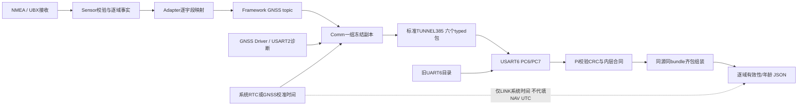

# GNSS统一出口与树莓派MAVLink对接

最终构建补记：保留当前工程的设备包3.1.1更新后，于2026-11-06 16:26:53—16:27:16 UTC+8再次Rebuild All，0错误0警告、日志21s；1034项当前工程输入一致，HEX仍为`142625cf096ab67b9a16e79473a05bfb8b7ee8ac8c0a1ce948279682decf0958`。当前源码ZIP SHA-256为`c00f832a9879501b652f6d2e66fbabb459183cea696d80b38a74168429226753`；源码与固件已按本次构建匹配。


日期：2026-11-06。本版说明阶段一typed GNSS出口、Pi参考解码器及旧UART6目录兼容。NMEA和UBX在STM32内部归一化，上位机读取同一套带来源/时效的字段，不再依赖GPS型号或解析原始文本。

**最终集成候选（R55 / V1-E51）**：typed v1与独立RAW通道已合并，归档见[MANIFEST](../Release/Archive/2026-11-06_gnss-unified-raw-uplink/MANIFEST.md)及[构建证据](../Release/Archive/2026-11-06_gnss-unified-raw-uplink/build_evidence.json)。HEX `cns-f407-gnss-unified-raw-20261106.hex`，SHA-256 `142625cf096ab67b9a16e79473a05bfb8b7ee8ac8c0a1ce948279682decf0958`；38组选定C host、31项Python均通过，Keil Rebuild All 0错误0警告、日志21s（15:53:07—15:53:30 UTC+8），1034项输入构建前后不变。主SRAM122392B、余8680B，比阶段一增加5648B。下文typed v1字段与旧目录合同保持；独立原帧见[RAW对接说明](2026-11-06_GPS原始帧MAVLink转发与树莓派对接.md)，不能用RAW直接续期导航。此新包未烧录/实板验收，既有Debug观察配置堆估算79.22%高于75%目标，资源、时序、定位和长稳待验，M5/M6不整体关闭。

以下为先完成的阶段一记录（R54 / V1-E50），保留为构建来源与可回退证据：

主代理已完成本轮35组选定host及实际Keil Rebuild All 0错误0警告、日志24s；Pi参考解码器19项测试及真实C生成6个wire黄金向量交叉通过。阶段一候选 `cns-f407-gnss-unified-20261106.hex`，SHA-256：`05a54692aae5df225c1da484b880b49a7ac07fcee032f88589f77c2779570e9c`；Keil实际15:04:16—15:04:43 UTC+8、1032项生产输入一致，主SRAM116744B/余14328B；软件交付保存在 `build/20261106_gnss_unified_uplink/delivery/`；**尚无本轮新固件UART6实板、定位精度、时钟对齐、资源或长稳验收结论**。黄金向量是确定性host数据，不是现场定位记录。

## 1. 数据范围与权威来源

新GNSS权威数据为标准MAVLink2 TUNNEL msg385中的本地payload_type **0x8011..0x8014**。这是本项目内层协议v1，不是新增MAVLink消息号或已注册方言。

本轮实际提供：位置/海拔/二维地速航迹/UTC/可用解状态及总used satellites；G/P/T/V/H/N/E七项DOP报告；严格NMEA来源的GPS/北斗visible/used四项计数；Driver、GNSS USART2传输与系统时间诊断。

本轮没有完整逐星NAV-SAT数组/星图、UBX逐星座计数、完整PVT所有扩展字段、三维速度、罗盘、PPS捕获或RTK接入。UBX只有总used数时，GPS/北斗分类必须Unknown，不能按总数猜分。协议字典列出的字段不等于此typed接口全部已提供。

旧GPS_RAW_INT(24)、GNSS_SAT(252)、GNSSUTC(252)保留为**legacy兼容，不能与新权威字段混用或续期**。旧其他域遥测、RemoteID及H1/B1也保留；完整目录见附录。



## 2. 串口、外层和六包顺序

F407 USART6 PC6 TX / PC7 RX，启动115200 8N1；与GPS USART2和Debug USART1分开。既有B1实验仍可临时改UART6为57600，复位恢复115200。system id为配置Node ID(1..250)，本出口component id=193。

外层MAVLink2 `FD / len / incompat / compat / seq / sysid / compid / msgid(3B) / payload / checksum(2B)`；若签名标志置位，尾部另有13 B签名。TUNNEL **msgid385、CRC-extra147**，必须先验CRC。CRC只证明该帧校验通过，不是身份认证；参考decoder识别签名长度，但没有密钥验签，`signature_verified=false`。

TUNNEL标准payload最多133 B，布局：offset0 U16LE payload_type；2 U8 target_system；3 U8 target_component；4 U8 payload_length；5起128 B payload。当前typed出口target0/0。**MAVLink2可裁剪尾部零**：先按标准解码补零至133 B，再按payload_length取内层32/64 B；不能拿实际物理尾长判断内层必须“缺字节”，也不能把payload_type误当msgid。

| bundle帧号 | payload_type | kind | 内层长度 | part_index / part_count |
|---:|---|---:|---:|---|
| 0 | 0x8011 NAV | 1 | 64 B | 0 / 1 |
| 1 | 0x8012 DOP | 2 | 64 B | 0 / 2，G/P/T/V |
| 2 | 0x8012 DOP | 2 | 64 B | 1 / 2，H/N/E |
| 3 | 0x8013 COUNTS | 3 | 32 B | 0 / 1 |
| 4 | 0x8014 LINK | 4 | 64 B | 0 / 2 |
| 5 | 0x8014 LINK | 4 | 64 B | 1 / 2 |

约1Hz创建一个新的冻结bundle，无定位/无数据也发送全套Unknown状态，用于清除Pi旧缓存。它不是原GPS导航更新率，也不是六个物理同时测量。未裁尾未签名时六包合计最多454 B，另有旧目录和重试流量；不据此声明CPU/堆或实时性已达标。

## 3. 冻结内容与实时年龄（必须遵守）

每组只复制一次GNSS/诊断/系统时间，bundle_id与snapshot_uptime_ms固定；**每次实际编码/重试重新计算age、valid、stale**。所以年龄是本次编码时源数据年龄，不是`header.snapshot_uptime_ms - source_time`，不能据此反推出源时刻。重试可更新时效元数据，底层观测仍来自同一组冻结副本；无效工程值可能按编码规则变成零占位。

C端每包最多3次尝试（含首次），失败至少等50ms；成功或耗尽尝试才推进下一片。新1s周期取消未完成旧组，不追赶积压。B1/H1/COMMAND_ACK仍先处理；之后普通遥测、专属状态和新GNSS三路轮转共享一次UART提交预算，RemoteID既有调用链另行保留。失败可能导致Pi只收到部分组；不能等到片1时把上一组片0补进去。

Pi应以`(sysid,compid,bundle_id,snapshot_uptime_ms)`关联，DOP/LINK都须两片齐全才得到完整组；本参考实现更保守，**六包全部齐才原子发布gnss_bundle**。同源新组未齐时保留上一完整组并继续过期处理。重复同片不重复发布；只更新年龄/有效位的合法重试允许合并，真实冻结值冲突则隔离该组。

Pi按每片各自本地到达后已等待时长给年龄增加值，不能用MCU uptime减Linux monotonic。重试乱序不能使已知年龄倒退。组装后的缓存再次读取也要重新年龄检查；本工具`assembler.current(monotonic_ms)`与`age_bundle()`提供此入口。无同步时钟不能消除单向串口/USB/网络缓冲延迟：valid只证明编码时有效，加本地等待是保守处理，并非已实现端到端同步或延迟上界保证。

bundle id和uptime均可回绕/重启。参考解码器支持uint32正常回绕；出现回退清掉同源缓存并标记epoch_reset。但**回退可能是重启，也可能是迟到旧包；连接会话及这四元组没有唯一设备boot_id保证**。同Node ID的不同设备、整组旧包重放仍不能由此彻底区分，不能声称已提供强重启身份判定。

## 4. Unknown、NoFix、STALE与单位

所有内层多字节小端，I32为补码；不得传C结构体内存。年龄U16：`65535=Unknown`、`65534=至少65534ms`、0ms合法；新鲜范围为0..1500ms（含），超过1500ms过期。valid/stale是present的子集，valid与stale不能重叠。未知工程值是JSON null，不能读零占位当真实测量。

| 情形 | 工程量处理 |
|---|---|
| present=0 | UNKNOWN；即使wire数值0或保留旧source/age，也不能复活旧工程值 |
| present=1、stale=1 | STALE；年龄可能饱和或Unknown，value=null |
| present=1、新鲜但valid=0 | 该工程量不可用；DOP可保留reported，不能当可用精度 |
| 状态valid且fix_quality=0 | NO_FIX是合法状态，真实used=0也合法；不代表Unknown |
| 位置valid且经纬均0 | 合法0°/0°，不能当空值 |
| 时间valid且当日秒0 | 合法UTC午夜，不是“未收到” |
| COUNTS valid且数值0 | 已知0；没有present/valid则null，不能用0替Unknown |

### 4.1 source枚举（与系统时间source不同）

0 NONE；1 UBX_PVT；2 NMEA_GGA；3 NMEA_RMC；4 NMEA_GSA；5 NMEA_GSV；6 UBX_DOP。逐域来源不等于最后收到的协议，混合流可同时有PVT位置、RMC速度、GGA高度等历史事实，必须各自检查时效。

NAV的sources_pack为位置/速度/UTC/高度/状态五域依次各3bit，bit15保留。 来源组合也严格限定：NAV位置/高度/状态只0/1PVT/2GGA，速度/UTC只0/1PVT/3RMC，HDOP只0/2GGA/4GSA/6UBX_DOP；DOP的G/T/N/E只0/6，P只0/1/4/6，V只0/4/6，H只0/2/4/6；COUNTS visible只0/5GSV、used只0/4GSA。不是任意合法枚举都可填任意字段，错组合拒绝。mask bits0..5分别position、velocity、time、altitude、navigation_status、hdop。status的fix_quality_gga沿用GGA质量码；raw_status_type按status_source解释为PVT.fixType或GGA原质量码，不能当MAVLink GPS_FIX_TYPE。fix_dimension=0表示未提供，不伪造2D/3D。 GGA质量码为0无fix、1普通GNSS、2差分、3PPS、4RTK fixed、5RTK float、6估算/DR、7手工、8模拟；本轮普通坐标只结合1/2/4/5及真实域授权，其他状态不自动授权坐标，枚举4/5也不证明硬件RTK已接入。PVT raw_status_type为0无fix/1仅DR/2二维/3三维/4GNSS+DR/5仅时间，须按status_source区分。

经纬degree×1e7；海拔MSL为mm；二维地速cm/s、航迹0.01deg；UTC为YYYYMMDD和当日秒，不加8小时。当前v1日期表示2000..2099、秒0..86399；未授权或越界值为null/拒绝，不把RTC填入该GNSS时间。UTC来源和位置独立，无fix仍可能有可用UTC。

### 4.2 DOP报告与可用值

IDs0..6为G/P/T/V/H/N/E，reported_value_x100有效范围1..65534、换算除100，无量纲，**不是米制误差或实测精度保证**。flags bit0 present、bit1 valid、bit2 stale、bit3 itow_known，其余保留。

present表示接收过该报告；valid还依该来源是否报告可用解和年龄等C端授权。即使全局PVT有fix，GSA1无解报告的DOP也只能reported，不能变成usable。Pi分别输出`reported_x100/reported_factor`和`value`；REPORTED_ONLY/STALE仍可审计reported，但value为null。pDOP不能冒充hDOP。

UBX iTOW已知时保留周内ms，0也合法；**NMEA没有iTOW，known=0时输出null，不能把wire零占位当GPS周开始**。每项DOP保留自己的source/age/iTOW；整组冻结不保证七项来自同一物理历元，更不能靠bundle header拼造测量epoch。

### 4.3 分类计数

COUNTS bits0..3依次GPS visible、BDS visible、GPS used、BDS used，四项各有present/valid/stale/source/age。当前由严格NMEA GSV/GSA产生，GP/BD/GB等已识别来源才授权；GSA无解且空ID可以提供已知used0。UBX PVT总used不按星座拆分；当前UBX per-constellation通常Unknown，不能拿旧GNSS_SAT或原帧NAV-SAT个别样本补成此typed包已经授权的分类。

### 4.4 LINK是GNSS UART2与系统时钟事实

diagnostic_flags bit0 Driver新鲜可用、bit1传输副本可用、bit2见过字节、bit3见过有效帧、bit4见过版本、bit5 UART/DMA初始化完成、bit6 GNSS TX忙，bit7保留。Driver和BSP可用性独立；缺副本的业务计数为null，真实计数0可用。rx/drop/UART/DMA/tx_packets/recoveries均是**GPS USART2**事实，不是UART6六包的上报完成/丢包统计。

receiver_protocol=0未知/1NMEA/2UBX；receiver_state=0探测/1版本/2配置/3接收/4未确认/5IO错误/255未知。config_confirmed只说明配置应答与后续PVT确认流程，不是定位/精度验收。last_byte_age_ms/last_frame_age_ms为U32，0xFFFFFFFF未知，其余按编码时年龄解释。

LINK系统时间另受C端2500ms副本门限、日期/时间和源检查授权，不与NAV测量1500ms门限混用；wire没有独立系统时间源年龄字段。系统时间source为另一枚举：0NONE、1RTC、2GNSS；sync_state为0INVALID、1RTC_VALID、2GNSS_SYNCED、3STALE。time_available=0时系统时间业务字段均null，保留原始字节仅供审计。time_available=1可报告独立系统UTC，**绝不代填NAV GNSS UTC**。

既有wire没有“曾同步”seen位：RTC source=1且reported sync_age_s=0，既可能从未校准，也可能刚校准不足1s。本decoder保留`reported_sync_age_s=0`，但`sync_age_s=null, sync_age_known=false`，不宣称刚GPS授时；RTC正数或当前sourceGNSS=2时可解释，GNSS源0秒合法。

## 5. 精确逐字段布局

下面表由冻结wire_layout.json字段清单生成；offset均相对**内层payload**，不是MAVLink整帧。COMMON头在所有六包相同；DOP entry的offset相对各12 B记录，part0四条/part1三条，未使用尾部补零。各组固定长度不可更改。

### COMMON头：0..11 B

| offset | wire类型 | 字段 | 单位/授权 |
|---:|---|---|---|
| 0 | u8 | version | 固定1 |
| 1 | u8 | kind | 与payload_type一致：1NAV/2DOP/3COUNTS/4LINK |
| 2 | u8 | part_index | 本组片号，从0开始 |
| 3 | u8 | part_count | 本组固定1或2 |
| 4 | u32 | bundle_id | uint32组代数，可回绕/重启，非唯一boot ID |
| 8 | u32 | snapshot_uptime_ms | 整组冻结时开机ms，不是编码时刻或测量epoch |

### 0x8011 GNSS_NAV：每片64 B

| offset | wire类型 | 字段 | 单位/授权 |
|---:|---|---|---|
| 12 | u8 | valid_mask | 本组有效位；工程量还需年龄/范围授权 |
| 13 | u8 | stale_mask | 本组过期位；value为null |
| 14 | u16 | sources_pack | 五域各3bit，顺序位置/速度/UTC/高度/状态；bit15保留 |
| 16 | u8 | fix_quality_gga | GGA质量码，不是MAVLink GPS_FIX_TYPE；0可为有效NoFix |
| 17 | u8 | fix_dimension | 0未知、2二维、3三维；不自猜维度 |
| 18 | u8 | satellites_used | 当前总used卫星数，0合法；只由状态位授权 |
| 19 | u8 | hdop_source | 独立HDOP来源枚举 |
| 20 | i32 | latitude_e7 | I32 degree×1e7，范围±900000000 |
| 24 | i32 | longitude_e7 | I32 degree×1e7，范围±1800000000 |
| 28 | i32 | altitude_msl_mm | I32平均海平面高度mm |
| 32 | u32 | ground_speed_cms | U32二维地速cm/s |
| 36 | u16 | course_cdeg | U16航迹0.01deg，有效0..35999 |
| 38 | u16 | hdop_x100 | HDOP×100，不能填pDOP；有效1..65534 |
| 40 | u32 | utc_date_yyyymmdd | 真实GNSS UTC日期YYYYMMDD，当前2000..2099 |
| 44 | u32 | utc_second_of_day | 真实GNSS UTC当日秒0..86399，0为午夜 |
| 48 | u16 | position_age_ms | U16本次编码时该域年龄ms；FFFF未知、FFFE饱和，0合法 |
| 50 | u16 | velocity_age_ms | U16本次编码时该域年龄ms；FFFF未知、FFFE饱和，0合法 |
| 52 | u16 | time_age_ms | U16本次编码时该域年龄ms；FFFF未知、FFFE饱和，0合法 |
| 54 | u16 | altitude_age_ms | U16本次编码时该域年龄ms；FFFF未知、FFFE饱和，0合法 |
| 56 | u16 | status_age_ms | U16本次编码时该域年龄ms；FFFF未知、FFFE饱和，0合法 |
| 58 | u16 | hdop_age_ms | U16本次编码时该域年龄ms；FFFF未知、FFFE饱和，0合法 |
| 60 | u16 | link_age_ms | U16最近有效GNSS帧年龄，65535未知 |
| 62 | u8 | present_mask | 本组明确提供/有来源的域，不等于值非0 |
| 63 | u8 | raw_status_type | 按status_source解释为PVT.fixType或GGA质量码 |

### 0x8012 GNSS_DOP：每片64 B

| offset | wire类型 | 字段 | 单位/授权 |
|---:|---|---|---|
| 12 | u8 | entry_count | part0固定4、part1固定3 |
| 13 | u8[3] | reserved | 全部0，禁止解释 |

#### entry：从offset16起，每条12 B

| offset | wire类型 | 字段 | 单位/授权 |
|---:|---|---|---|
| 0 | u8 | id | 0..6为G/P/T/V/H/N/E，按固定片/行顺序 |
| 1 | u8 | source | 独立来源枚举，不是最后收到协议 |
| 2 | u8 | flags | DOP bits0present/1valid/2stale/3iTOWknown |
| 3 | u8 | reserved | 全部0，禁止解释 |
| 4 | u16 | reported_value_x100 | 报告值×100，1..65534；usable需valid位 |
| 6 | u16 | age_ms | 本次编码年龄ms；FFFF未知、FFFE至少65534 |
| 8 | u32 | itow_ms | GPS周内ms<604800000，仅known位授权；未知wire0→JSON null |

part0包含id0..3；part1包含id4..6，part1 offset52..63补零。

### 0x8013 GNSS_COUNTS：每片32 B

| offset | wire类型 | 字段 | 单位/授权 |
|---:|---|---|---|
| 12 | u8 | present_mask | 本组明确提供/有来源的域，不等于值非0 |
| 13 | u8 | valid_mask | 本组有效位；工程量还需年龄/范围授权 |
| 14 | u8 | stale_mask | 本组过期位；value为null |
| 15 | u8 | reserved | 全部0，禁止解释 |
| 16 | u8 | gps_visible | 分类卫星数U8；present/valid授权时0合法，否则null |
| 17 | u8 | bds_visible | 分类卫星数U8；present/valid授权时0合法，否则null |
| 18 | u8 | gps_used | 分类卫星数U8；present/valid授权时0合法，否则null |
| 19 | u8 | bds_used | 分类卫星数U8；present/valid授权时0合法，否则null |
| 20 | u8 | gps_visible_source | 该计数独立来源；visible=NMEA_GSV，used=NMEA_GSA |
| 21 | u8 | bds_visible_source | 该计数独立来源；visible=NMEA_GSV，used=NMEA_GSA |
| 22 | u8 | gps_used_source | 该计数独立来源；visible=NMEA_GSV，used=NMEA_GSA |
| 23 | u8 | bds_used_source | 该计数独立来源；visible=NMEA_GSV，used=NMEA_GSA |
| 24 | u16 | gps_visible_age_ms | U16该分类计数本次编码年龄ms，Unknown/饱和同上 |
| 26 | u16 | bds_visible_age_ms | U16该分类计数本次编码年龄ms，Unknown/饱和同上 |
| 28 | u16 | gps_used_age_ms | U16该分类计数本次编码年龄ms，Unknown/饱和同上 |
| 30 | u16 | bds_used_age_ms | U16该分类计数本次编码年龄ms，Unknown/饱和同上 |

### 0x8014 GNSS_LINK：每片64 B

#### part 0

| offset | wire类型 | 字段 | 单位/授权 |
|---:|---|---|---|
| 12 | u8 | diagnostic_flags | LINK bits0Driverfresh/1transport/2rx_seen/3frame_seen/4version_seen/5initialized/6tx_busy |
| 13 | u8 | receiver_protocol | 0未知/1NMEA/2UBX，Driverfresh才业务可用 |
| 14 | u8 | receiver_state | 0Detect/1Version/2Config/3Receiving/4Unconfirmed/5IO/255Unknown |
| 15 | u8 | config_step | 已确认步骤，不能超过total |
| 16 | u8 | config_total | 本组所需配置步骤总数 |
| 17 | u8 | config_confirmed | 0/1；配置握手事实，不等于定位验收 |
| 18 | u16 | protocol_version_x100 | 报告协议版本×100，需version_seen授权 |
| 20 | u32 | gnss_baud_bps | GNSS USART2 bit/s，优先实际BSP；不是UART6码率 |
| 24 | u32 | rx_bytes | GNSS Driver累计消费B |
| 28 | u32 | valid_nmea | Driver校验正确NMEA累计帧 |
| 32 | u32 | valid_ubx | Driver校验正确UBX累计帧 |
| 36 | u32 | checksum_errors | Driver校验失败累计次数 |
| 40 | u32 | framing_resets | Driver组帧重置累计次数 |
| 44 | u32 | rx_drop_bytes | GNSS USART2已观察覆盖/重建舍弃B |
| 48 | u32 | uart_errors | GNSS USART2错误累计次数 |
| 52 | u32 | dma_errors | GNSS RX DMA错误累计次数 |
| 56 | u32 | last_byte_age_ms | U32本次编码距最近消费字节ms，FFFFFFFF未知 |
| 60 | u32 | last_frame_age_ms | U32本次编码距最近有效帧ms，FFFFFFFF未知 |

#### part 1

| offset | wire类型 | 字段 | 单位/授权 |
|---:|---|---|---|
| 12 | u8 | time_available | 系统时间独立0/1可用位，0业务全部null |
| 13 | u8 | system_time_source | 0NONE/1RTC/2GNSS，不是GNSS域source枚举 |
| 14 | u8 | system_time_sync_state | 0INVALID/1RTC_VALID/2GNSS_SYNCED/3STALE |
| 15 | u8 | reserved | 全部0，禁止解释 |
| 16 | u32 | time_sync_age_s | 原同步龄期s；RTC+0存在歧义，保留reported但业务未知 |
| 20 | u32 | tx_commands | Driver实际提交GNSS查询/配置命令累计数 |
| 24 | u32 | ack_count | GNSS模块ACK累计数，不是Pi ACK |
| 28 | u32 | nak_count | GNSS模块NAK累计数 |
| 32 | u32 | config_timeout_count | GNSS查询/配置超时累计数 |
| 36 | u32 | tx_packets | GNSS USART2完整TX累计数，不是UART6上报数 |
| 40 | u32 | tx_failures | GNSS USART2失败累计数 |
| 44 | u32 | recoveries | GNSS USART2成功恢复累计数 |
| 48 | u32 | transport_rx_bytes | BSP观察到的GNSS DMA累计B |
| 52 | u16 | dma_ndtr_bytes | GNSS RX DMA剩余B，当前0..1024 |
| 54 | u16 | queued_bytes | GNSS BSP未消费B，当前不超过1024 |
| 56 | u32 | system_utc_date_yyyymmdd | 独立系统UTC日期YYYYMMDD，可来自RTC，不填NAV.UTC |
| 60 | u32 | system_utc_second_of_day | 独立系统UTC当日秒，0合法，不填NAV.UTC |

## 6. C端和Pi端职责

| C端 | Pi端 |
|---|---|
| Sensor校验/解析NMEA与UBX并发布真实逐域来源/时间，坏字段撤销授权 | 不解析NMEA/UBX字符串来补typed包未提供的字段 |
| Adapter逐字段映射；Comm冻结同组观测，各次编码更新age/valid/stale | 先MAVLink CRC，再严格version/kind/part/length/保留位/范围/年龄验证 |
| 1s六包、每包最多3次、50ms退避，新周期取消未齐旧组；旧目录保留 | 严格同源四元组去重/齐包，绝不跨组补片，按片增加本地等待并继续过期 |
| 明确Unknown/NoFix/STALE，不由ACK/RTC/卫星数续期旧位置 | 无效工程量null，known0/Unknown分离；旧GNSS消息只兼容不续新权威 |
| 不假定Pi/Server实际收到 | 不把CRC、计数、配置确认或连接会话当成设备认证/唯一boot ID/实测精度 |

## 7. Pi参考程序与使用步骤

文件：[Tools/gnss_uart6_decoder.py](../Tools/gnss_uart6_decoder.py)，Python3.9及以后，离线只用标准库。脚本内置冻结v1常量，运行不依赖build目录或外部JSON；最终随包布局JSON是审计资料。

先离线验证：

```bash
python3 Tools/gnss_uart6_decoder.py --input uart6_frames.bin
python3 Tools/gnss_uart6_decoder.py --hex @uart6_frames.hex
python3 Tools/gnss_uart6_decoder.py --hex "FD..."
python3 Tests/Unit/test_gnss_uart6_decoder.py -v
```

第三行仅为命令格式占位，需替换成完整纯HEX；不要把Debug时间前缀/省略号当字节输入。`--input`为MAVLink二进制流，`--hex`为纯HEX或@HEX文本文件。`--packets`额外输出单片供排查，业务先消费齐全的`gnss_bundle`，并应用同键`gnss_invalidated`及`gnss_metadata_update`授权更新，不能用单片替换完整组；离线坏帧输出error且非零退出。

只有显式使用`--port`才导入可选pyserial并打开指定串口；程序没有串口命令发送路径，不自动扫描或连接现有设备。下面端口仅示例，替换为实际UART6连接设备：

```bash
python3 Tools/gnss_uart6_decoder.py --port /dev/ttyUSB0 --baud 115200
```

默认输出JSON Lines。`gnss_bundle.groups.nav`为六个逐域对象；每项有present/valid/stale/state/source、encoded_age_ms、age_ms和value。encoded_age_ms保留C本次编码年龄，age_ms加该片本地已等待；value只在当前授权有效时有值。DOP另保留reported及独立itow_known，COUNTS缺失为null，LINK.system_time与NAV.time独立。

客户端集成可调用`Decoder.feed(bytes, now_ms=Linux单调毫秒)`，并定时调用`decoder.assembler.current(同基准单调毫秒)`取得继续过期后的最新完整状态。不要只缓存第一次输出的valid永远不重算。持续调用`feed(b"", now_ms=...)`或`assembler.expire(now_ms)`，即使断流也会老化已发布缓存，超过1500ms的工程量变为valid=false/value=null；LINK当前状态、计数和系统时间也保守失效，原整数只留reported。授权发生变化时输出gnss_invalidated，持续断流无新状态变化不重复刷事件；重试造成合法授权更新时用gnss_metadata_update。公开completed缓存同步更新，current也执行老化。未知local type返回unknown_tunnel及原始/补零后bytes，旧标准消息保留msgid/name/payload并标非权威GNSS；当前目录CRC-extra已识别，其余未知消息不谎称CRC已验证。

默认每源最多一组待齐缓存、32个来源，待齐超时1500ms；新组替换旧待齐组，完整旧组独立保存并过期。相同冻结字段冲突的重复片会隔离，合法重试的元数据允许更新，不能倒龄或将重复接收当新样本。可通过`--bundle-timeout-ms`调整主机待齐窗口，但不能把它当源测量有效门限或已测网络延迟。

## 8. 验证与仍待完成的证据

Pi测试19项通过，含0ms、UTC午夜0、有效坐标0、NoFix/真实星数0、reported DOP与usable分离、NMEA iTOW Unknown、COUNTS Unknown/known0、严格64/32长度、保留位/范围/age、错误CRC、签名长度、MAVLink2零尾裁剪、旧消息/未知local type、分片乱序/去重/原子替换、过期、正常回绕、回退清缓存和不同source隔离、合法metadata重试与本地不倒龄，以及RTC同步0歧义。

Tests内置真实C codec+标准MAVLink生成的六帧黄金向量（sys42/comp193/bundle1/snapshot1000，编码1000..1050）。交叉解码得到同一个完整bundle：lat=-123456789、各片等待后位置age50ms，HDOP reported105/source NMEA_GSA且itow=null，分类0/14/0/8，独立系统RTC。该向量的质量码/数值仅为测试，不是P25实测能力或RTK通过证据。

固件Keil24s/0E0W、35组选定host由主代理统一完成；最终HEX/SHA及资源、同版UART6实收/接入、断流热插拔/时效、系统时钟对齐和端到端延迟、堆峰值/栈水位、定位精度与长稳仍按同候选证据填写，不复用早先raw/Frames版本当新出口通过。既有Debug观察配置79.22%堆预算不是本轮运行资源实测，也不代表75%目标通过。

## 附录：完整旧UART6目录（兼容保留）

**以下整合接入前库存的每条发送项、单位与timebase；旧GNSS24/GNSS_SAT/GNSSUTC均非新权威。** 新typed调度已改为三路轮转共享一次UART提交预算，旧字段的周期/编码条件仍保留。旧源码SHA只作库存时点审计，不能当本轮最终候选身份。

### 兼容目录的物理口、身份与调度

- 树莓派链路为USART6 PC6 TX / PC7 RX，启动115200 8N1；既有B1实验可临时切57600，复位恢复115200。它与GNSS USART2及Debug USART1独立，UART6不是GPS UBX原字节透传口。
- 线上MAVLink system id来自启动Node ID，当前规则1..250；所有经RPi专属/镜像函数外发的component id改为**193**。编码阶段的191/RemoteID192不能当作UART6最终线上compid。
- RPi使用独立8位发送序号，各目录、RemoteID镜像、事件应答共用，CRC按改写后的头重算。不得把其他链路的seq与UART6混算。
- CommTask为唯一发送者；RPi发送不受LoRa在线/空口状态或RPICELL/5G联网状态门控。目录周期都是调度目标，不是保证每个周期必有新帧；未就绪、过期、序号去重、串口BUSY/错误会延后或跳过。
- RPi普通遥测及6项专属均使用`max(原周期,1000ms)`。MODSTAT和MOTOR各有两分片轮转，所以某个具体name正常约每2s出现一次，不是每个name1Hz。
- 当前优先级仍B1响应→H1响应→本链COMMAND_ACK；无优先事件时，旧普通遥测/旧专属目录/新typed GNSS三路轮转共享一次UART提交预算。随后RemoteID独立调用链仍保留；旧字段周期不等于保证实际到达Hz。
- BSP使用阻塞HAL发送，超时参数20ms；成功只说明本机UART整帧发送完成，不证明Pi解码、MQTT、Server或RemoteID空中广播成功。

### 2. 普通遥测目录：15项，其中第一组电源当前关闭

下表周期为UART6实际调度下限。NAMED_VALUE_INT msg252必须再按10字节name区分；name按固定字段处理、去末尾NUL，不依赖整个接收缓冲区后面恰有字符串结束符。

| 目录项 | msgid / 线上名称 | UART6目标周期 | 当前字段、单位与时间基准 |
|---|---|---:|---|
| HEARTBEAT | 0 / HEARTBEAT | 1000ms | type=ONBOARD_CONTROLLER、autopilot=INVALID、state=ACTIVE；没有测量时间戳 |
| GPS_RAW | 24 / GPS_RAW_INT | 1000ms，有新GNSS序号才发 | 经纬degree×1e7；alt为GNSS海拔mm；vel为cm/s；cog为0.01deg。**time_usec=position_update_ms×1000，64位开机微秒，不是Unix UTC** |
| GNSS_DETAIL | 252 / GNSS_SAT | 1000ms，有新GNSS序号才发 | value按U32四字节打包GPS visible、BDS visible、GPS used、BDS used；time_boot_ms为编码时开机ms |
| ATTITUDE | 30 / ATTITUDE | 1000ms（原500ms） | roll/pitch/yaw为rad，三轴角速度rad/s；time_boot_ms为编码时开机ms。yaw来自现有姿态域，不证明磁北航向 |
| POSITION | 33 / GLOBAL_POSITION_INT | 1000ms（原500ms） | lat/lon degree×1e7，alt融合高度mm；vx/vy/vz为NED cm/s，hdg为0.01deg；time_boot_ms为编码时开机ms |
| BAROALT | 252 / BAROALT | 1000ms（原500ms） | value为融合高度mm，非单独气压传感器原始海拔；time_boot_ms为编码时开机ms |
| SYS_STATUS | 1 / SYS_STATUS | 1000ms | GPS/IMU/Baro present/enabled/healthy位；健康含ONLINE/DEGRADED。仅第一组BAT1可填电压/电流/SOC，当前BAT1关闭，故voltage=65535、current=-1、remaining=-1；不代填BAT2 |
| MODULE_STATE | 252 / MODSTAT0、MODSTAT1 | 目录1000ms，具体分片约2000ms | 每个value含8个4bit模块状态；time_boot_ms为编码时开机ms |
| BATTERY | 147 / BATTERY_STATUS，id=0 | **当前关闭** | 第一组PX4LITE_ENABLE_BATTERY1=0，不读取、不发送；不能只等id0 |
| BATTERY2 | 147 / BATTERY_STATUS，id=1 | 1000ms，有新电源序号才发 | voltages[0]为主回路mV，其余65535；current_battery为0.01A（mA/10经饱和转换），无效=-1；percent=-1、charge_state=UNDEFINED。没有源测量时间字段 |
| GNSSUTC | 252 / GNSSUTC | 1000ms | **value是十进制yymmdd；time_boot_ms被兼容协议复用为UTC当日秒0..86399，不是开机ms**。来自统一时间服务，可RTC兜底，不是纯GPS源证明 |
| PRESSURE | 29 / SCALED_PRESSURE | 1000ms | press_abs=Pa/100，为hPa；temperature为0.01°C；time_boot_ms为Baro采样开机ms。press_diff及差压温度为0占位，没有独立差压来源 |
| ENV_HUM | 252 / HUMIDITY | 1000ms | value=相对湿度%×10，夹0..1000；time_boot_ms为Baro采样开机ms |
| MOTOR | 252 / MOTOR12、MOTOR34 | 目录1000ms，具体分片约2000ms | 两路油门百分比、run_state及speed_level按位打包；time_boot_ms为已确认电机输出采样ms，不是RPM或ESC反馈 |
| MOTOR_PULSE | 36 / SERVO_OUTPUT_RAW | 1000ms | servo1..4_raw为四路PWM高电平µs，port0；其余通道零占位。**time_usec为32位sample_ms×1000，会约71.6min回绕** |

#### 2.1 现有GNSS兼容消息的有效边界

GPS_RAW和GNSS_SAT均要求fix_type非0、新鲜POSITION及topic，并对RPi独立去重。**无定位时会抑制，不代表UART6没通信，也不构成完整GNSS状态上报。** GPS_RAW高度失效时降为2D；速度无效时vel/cog=65535，eph未知=65535、epv=65535。其精度扩展h_acc/v_acc/vel_acc/hdg_acc置UINT32_MAX，alt_ellipsoid=0、yaw=0未提供。

GPS_RAW.satellites_visible当前只把旧GPS+BDS visible相加，不是PVT numSV总used；GNSS_SAT也只有旧GPS/BDS四项，并无新NAV-SAT逐星、所有星座或完整PVT字段。旧GGA质量码映射：2→DGPS、4→RTK_FIXED、5→RTK_FLOAT、其他非0默认3D；这不是本批模块具备RTK的证明。

GLOBAL_POSITION_INT要求POSITION/VELOCITY/ALTITUDE同时有效才发。relative_alt=0是占位；vz沿用Navigation字段，当前不能当成已经独立验证的垂速来源；hdg来自有效姿态yaw，无姿态时65535，不是新增罗盘读数。SYS_STATUS中load/错误统计等未填的零不能当作已实测资源为零。

#### 2.2 NAMED_VALUE_INT打包字段

bit打包value在MAVLink类型中是int32；Pi应先`value & 0xFFFFFFFF`再提取无符号位，不能因负值丢弃。

| name | U32布局 |
|---|---|
| GNSS_SAT | bits0..7 GPS visible；8..15 BDS visible；16..23 GPS used；24..31 BDS used |
| MODSTAT0 | bits4*i..4*i+3为module i，i0..7 |
| MODSTAT1 | 同规则为module8..15；当前只有0..13有效，14/15填0不能当真实模块 |
| MOTOR12 | bits0..7 motor1%、8..15 motor2%、bit16 run_state、bits24..31 speed_level%；其余保留 |
| MOTOR34 | 同规则为motor3/4 |

模块顺序0..13：GNSS、IMU、Baro、Power、LoRa、5G、Storage、RemoteID、Display、Control、Alarm、System、Estimator、Business。状态0..6：UNINITIALIZED、STARTING、ONLINE、DEGRADED、OFFLINE、FAILED、DISABLED。

### 3. RPi专属周期目录：6项

| 目录项 | msgid / 名称或payload_type | 周期 | value/时间基准与用途 |
|---|---|---:|---|
| RPILORA | 252 / LORASTAT | 1000ms | bits0..15为估算丢包率×10（0..1000对应0..100%）；16..23为LoRa Node ID；bit24在位；25..27模块状态。time_boot_ms=编码时开机ms |
| RPILORATX | 252 / LORATX | 1000ms | value为LoRa发送完成帧数，饱和INT32_MAX；time_boot_ms为LoRa最近TX完成开机ms |
| RPILORARX | 252 / LORARX | 1000ms | value为LoRa完整RX帧数，饱和INT32_MAX；time_boot_ms为LoRa最近合法MAVLink接收开机ms |
| RPIRID | 252 / RIDSTAT | 1000ms | 低16位为RemoteID位置提交计数，高16位为编码/提交错误低16位；time_boot_ms为RemoteID最近任一成功提交开机ms。不是RF接收或云端成功 |
| RPIALRM | 385 / TUNNEL 0x8001 | 1000ms | 全量活动告警表；target_system/component均0 |
| RPILOG | 385 / TUNNEL 0x8002 | 2000ms | 最近最多9条消息日志快照，重复周期重播；target_system/component均0 |

#### 3.1 既有0x8001告警表

payload头2 B：offset0 version=1，offset1 active_count=N；接N条7 B记录：source_id U8、fault_code U16LE、severity U8、active U8、age_s U16LE。age_s为本机`(now_ms-raised_ms)/1000`，饱和65535；它是告警年龄，不是UTC。只含active记录，校验声明长度至少`2+7*N`并遵循实际payload_length。

#### 3.2 既有0x8002日志表

payload头3 B：latest_seq U16LE、count U8；每条8 B：sequence U16LE、message_id U16LE、hour U8、minute U8、second U8、severity U8。没有单条文本，需事件ID字典；按sequence去重，不能把每次重播当新事件。

当前LocalMsgLogEvent把**开机毫秒转HHMMSS，小时按100循环**后存入日志。这里的三字节时分秒不是Unix、UTC或本地RTC时间。旧文档若称U24十进制时间也不能套用本表。最多9条×8+3=75 B。

### 4. 命令与TUNNEL事件响应

| 消息 | msgid | 触发/优先级 | 当前响应语义 |
|---|---:|---|---|
| COMMAND_ACK | 77 | 有本链COMMAND_LONG处理结果才发，先于普通周期目录 | command回原命令号，result=MAV_RESULT；progress=255，result_param2=0，target回请求来源sysid/compid。每链只一个待发槽，非所有命令历史队列 |
| H1响应 | 385 / 0x8003 subtype2 | 合法H1请求subtype1后，优先于ACK及遥测 | 版本1、原nonce8 B、N、原文本N B、实际baud U32LE；文本不解析UTF8、不当设备命令 |
| B1接受响应 | 385 / 0x8003 subtype4 | 合法B1请求subtype3后，最高优先级 | 14 B版本/类型/nonce8/目标baud U32LE；先在旧速率完整发送，再尝试切57600 |

H1 wire：请求`[version1,type1,nonce8,N,textN]`，N1..48；响应保持nonce/N/text，type改2，在末尾追加4 B当前bit/s，长度`15+N`。nonce为原始不透明字节，不是时间戳。精确目标必须为本机sysid/193，回复target取请求来源。

B1 wire：`[version1,type3或4,nonce8,baudU32LE]`，长度14。当前只允许一次启动周期从115200到57600；响应type4表示接受，不证明后续重配置必成功，应从新速率流量/实际状态确认。复位回115200，不写Flash；MAVLink2尾零裁剪由现有B1处理器显式恢复校验。H1/B1不应与未接入的旧RPI_EXPERIMENT草案混用。

这些应答本身没有采样时间；不可把nonce当timestamp，也不可用COMMAND_ACK表示电机物理动作或所有目标已实际达到。

### 5. RemoteID到UART6的5种消息

基础身份有独立RPi调度，不依赖ESP32 PC8在位。其余四种经RemoteID在位/恢复路径编码并镜像；镜像发生于UART4提交前，不能证明ESP32收到或已RF广播。RemoteID的HEARTBEAT明确**不镜像UART6**，所以不是第二种额外UART6心跳。

| msgid / 名称 | 目标周期 | UART6路径、字段与重要单位 |
|---|---:|---|
| 12900 / OPEN_DRONE_ID_BASIC_ID | 1000ms，失败重试100ms | 独立RunRpiIdentity，即使RemoteID未插也发；uas_id为20 B长期vendor产品身份、id_type=SERIAL_NUMBER；不是可变Node ID字符串 |
| 12901 / OPEN_DRONE_ID_LOCATION | 1000ms，需有效新位置 | 仅在位RemoteID路径镜像；lat/lon degree×1e7；direction0.01deg；水平/垂直速度cm/s；高度/相对height为m；timestamp为**UTC当前小时内秒**，未知65535 |
| 12904 / OPEN_DRONE_ID_SYSTEM | 1000ms，需有效统一UTC时间 | 操作者位置取已锁定home或当前位置占位，不是单独操作者GPS；坐标degree×1e7，高度/区域m；timestamp为**自2019-01-01 UTC起秒数**，不是1970 epoch或开机秒 |
| 12905 / OPEN_DRONE_ID_OPERATOR_ID | 1000ms | CAA类型，operator_id当前配置DCDW；只表示声明文本 |
| 12903 / OPEN_DRONE_ID_SELF_ID | 5000ms | TEXT类型，设备身份和序列号描述；不是定位或测量 |

RemoteID失败分支100ms重试；由于镜像在UART4提交前，Pi可能看到比目标周期更快的重复镜像，不能以每帧推断新定位。

LOCATION当前垂速始终6300（未知），方向在静止/无速度时36100（未知），水平速度未知25500，已知最大25425。altitude_barometric和altitude_geodetic当前都填同一个融合高度m，无独立椭球高测量契约，不能仅凭标准字段名认定为已验证的两种高度。relative height需home及有效高度，否则-1000。精度枚举部分由HDOP阈值估计，其余未知，不能当实测精度保证；status当前固定AIRBORNE也不是独立起落传感器事实。

## 下一阶段

独立原始帧通道现已实现，使用0x8020 RAW_FRAME与0x8021 RAW_STATS，详见[GPS原始帧MAVLink转发与树莓派对接](2026-11-06_GPS原始帧MAVLink转发与树莓派对接.md)。本文0x8011..0x8014仍只表示结构化数据，两者布局和用途不能混用。
