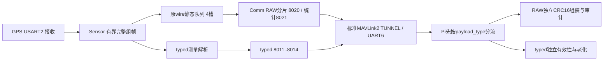

# GPS原始帧MAVLink转发与树莓派对接

最终构建补记：保留当前工程的设备包3.1.1更新后，于2026-11-06 16:26:53—16:27:16 UTC+8再次Rebuild All，0错误0警告、日志21s；1034项当前工程输入一致，HEX仍为`142625cf096ab67b9a16e79473a05bfb8b7ee8ac8c0a1ce948279682decf0958`。当前源码ZIP SHA-256为`c00f832a9879501b652f6d2e66fbabb459183cea696d80b38a74168429226753`；源码与固件已按本次构建匹配。


日期：2026-11-06。用途：为树莓派/上位机提供独立GPS原始报文通道的数据契约、接收方法和限制。来源：本仓库 `px4lite_gnss_raw_uplink.h/.c`、真实MAVLink发送链、Sensor原帧hook，以及Python/C host回归。读者：串口接收端、数据记录与GPS协议分析开发者。

本通道转发Sensor组出的完整NMEA/UBX原wire，不从typed工程量反向拼造报文。保留原GPS校验，包括BAD校验；不截断帧、不修校验、不把RAW报文转换成导航有效值。最终集成候选R55 / V1-E51已通过38组选定C host、31项Python（原typed 19项、RAW 12项）及唯一Keil工程Rebuild All **0错误0警告、日志21s**；已交叉核对真实C编码器的3片原帧与1条统计黄金向量。HEX `cns-f407-gnss-unified-raw-20261106.hex`，SHA-256 `142625cf096ab67b9a16e79473a05bfb8b7ee8ac8c0a1ce948279682decf0958`，见[归档MANIFEST](../Release/Archive/2026-11-06_gnss-unified-raw-uplink/MANIFEST.md)及[构建证据](../Release/Archive/2026-11-06_gnss-unified-raw-uplink/build_evidence.json)。1034项输入前后不变，主SRAM122392B、余8680B，比阶段一增加5648B；既有Debug堆估算79.22%高于75%目标。黄金向量是host合成数据，**不是GPS实测记录**；新包尚未烧录，板上吞吐、定位、资源与长稳仍未验收，不关闭M5/M6。

## 1. 先区分各类“GPS数据”

| 通道 | 外层/本地type | 用途 | 接收端处理 |
|---|---|---|---|
| typed统一出口 | MAVLink TUNNEL 385；0x8011—0x8014 | 带来源、有效位与时效的归一化NAV/DOP/COUNTS/LINK | 按独立6包合同组装，业务值服从授权及老化 |
| 本文原帧 | TUNNEL 385；0x8020 RAW_FRAME | 完整GPS wire的40B分片 | 独立组装、校验，输出 `gnss_raw_frame` |
| 本文原帧统计 | TUNNEL 385；0x8021 RAW_STATS | 原帧队列、拒绝、发送结果与年龄 | 独立输出 `gnss_raw_stats` |
| 旧标准GPS_RAW_INT | MAVLink msgid 24 | 标准结构化GPS测量消息，保留兼容 | **不是原GPS串口字节**，不得投入RAW组装 |
| USART1 Debug文本 | 独立Debug口的HEX采样 | 人工短时观察 | 不是本通道，也不是无损转发 |

typed字段、旧UART6消息目录及时间基准见[统一出口与树莓派MAVLink对接](2026-11-06_GNSS统一出口与树莓派MAVLink对接.md)。RAW必须先按TUNNEL外层 `payload_type` 分流：0x8020的第1字节是protocol，而0x8011等第1字节是kind，不能共用头解释。RAW的protocol=1表示NMEA；typed source=1表示UBX_PVT，两者是不同枚举空间。



## 2. 物理链路与MAVLink外层

F407 USART6：PC6 TX、PC7 RX，启动配置115200、8N1。GPS接收用USART2，USART1是Debug，两者不是Pi上报口。旧B1实验允许UART6临时57600，复位恢复115200；Pi需要匹配实际UART6配置。本参考工具只接收，不发送配置命令。

RAW使用标准MAVLink2 msgid=385（TUNNEL），CRC-extra=147；system id为本机Node ID（1—250），component id=193。TUNNEL标准载荷最多133B：

| 外层payload偏移 | 类型 | 字段 | 解释 |
|---:|---|---|---|
| 0 | u16 | payload_type | 0x8020或0x8021，小端 |
| 2 | u8 | target_system | 当前发送为0 |
| 3 | u8 | target_component | 当前发送为0 |
| 4 | u8 | payload_length | 内层实际长度，RAW_FRAME 25—64、RAW_STATS 64 |
| 5 | u8[128] | payload | 内层数据，未用尾部为0 |

所有多字节整数小端。MAVLink2可能省略payload末尾0；接收端先验证实际MAVLink长度及CRC，再补0到标准TUNNEL的133B，最后按 `payload_length` 取内层。不要把省略的0当缺片，也不要把128B填充尾部当GPS字节。可带签名帧的总长还包含13B签名；参考工具正确消费，但没有密钥时不验证签名，CRC通过不等于来源认证。

## 3. RAW_FRAME：0x8020

内层为24B头加1—40B原字节；最大64B。字段没有对齐填充。

| 偏移 | 类型 | 字段 | 规则/单位 |
|---:|---|---|---|
| 0 | u8 | version | 1 |
| 1 | u8 | protocol | 1=NMEA，2=UBX；不是typed source |
| 2 | u8 | flags | bit0=源GPS校验有效；bit1=整帧CRC16存在，必须1；其余0 |
| 3 | u8 | header_length | 24 |
| 4 | u32 | frame_id | RAW独立事件序号，不是typed bundle_id |
| 8 | u32 | received_uptime_ms | Sensor完整消费/组帧完成时刻，毫秒；0合法 |
| 12 | u16 | frame_length | 完整原wire长度；NMEA≤128，UBX 8—1024B |
| 14 | u16 | fragment_offset | 本片原wire起始偏移，必须=40×index |
| 16 | u8 | fragment_index | 从0开始 |
| 17 | u8 | fragment_count | ceil(frame_length/40)，最大26 |
| 18 | u8 | data_length | min(40, frame_length-offset) |
| 19 | u8 | nmea_type | NMEA：0其他、1GGA、2RMC、3GSA、4GSV；UBX为0 |
| 20 | u8 | ubx_class | UBX class；NMEA为0 |
| 21 | u8 | ubx_id | UBX message id；NMEA为0 |
| 22 | u16 | wire_crc16 | 覆盖完整原wire的CRC16-CCITT-FALSE |
| 24 | u8[data_length] | data | 原字节，不含任何额外补齐/终止符 |

源字节范围：NMEA保留实际 `$`、正文、`*hh`、真实行终止符（通常CRLF）；源缺/坏校验但具有完整 `$..LF` 边界的短句也可作为BAD原帧观察。UBX保留 `B5 62 class id LE16length payload CK_A CK_B`。不得使用重新BuildFrame后的校验替代实收校验。常见名称仅用于标签：01/07 NAV-PVT、01/04 NAV-DOP、01/35 NAV-SAT、0A/04 MON-VER、05/01 ACK-ACK、05/00 ACK-NAK；未列出的class/id保留为OTHER，不推断接收机型号或功能。

当前UBX组帧payload上限1016B，对应1024B完整wire，最多26片；64颗卫星的标准NAV-SAT为8B头+64×12B记录+8B UBX外壳=784B，可完整转发。1024B边界为26片，前25片40B、最后24B。NMEA组帧仍128B。超过容量拒绝并记源拒绝统计，不能发截短的“完整帧”。这不是任意长度UBX或整个UART字节流的镜像：噪声、半帧、超长候选和重同步丢弃无法还原为完整RAW帧。

屏幕捕获与USART1 Debug仍用各自392B缓存；较长帧可以通过本MAV原帧通道，而屏幕capture_drop增长，两者不是同一缓存/容量，不能据屏幕空白判断本通道必未发出。

### 3.1 三层校验分别判断

1. 每个MAVLink片：MAVLink2 X25 CRC及CRC-extra147，失败不投入组装。
2. 全部片齐全：CRC16-CCITT-FALSE，poly=0x1021、init=0xFFFF、refin=false、refout=false、xorout=0；覆盖完整原wire。标准检查串ASCII `123456789` 得0x29B1。
3. 原GPS协议：保留并独立重算NMEA XOR或UBX Fletcher8，输出reported/recomputed/consistent。GPS BAD仍是可成功传输的RAW事件，不能因GPS BAD把外层传输判为失败，也不能修正字节。

即使三层均通过，也只证明封装与源校验，**不证明fix、位置/时间有效性或精度**。参考事件中 `source_checksum_confirmed` 只表示源校验报告与重算都成立；`usable_as_navigation_update=false`、`authoritative_navigation=false`、`navigation_validity="not_evaluated"` 固定保留，绝不授权导航。业务导航应消费typed授权值；若Pi自行解析RAW，需独立落实原厂字段有效位、版本、单位、历元和时效规则。

### 3.2 合成HEX例子

以下是人工构造的ACK-ACK（确认06/8A）封装示例，用于离线验证，**不是现场GPS收到的数据，也不是让用户向GPS发送命令**。sysid=1、compid=193、frame_id=1、received_ms=0、flags=3、单片；整帧CRC16=0xAC16。

```text
GPS原wire（10B）:
B5 62 05 01 02 00 06 8A 98 C1

RAW内层（24+10=34B）:
01 02 03 18 01 00 00 00 00 00 00 00 0A 00 00 00
00 01 0A 00 05 01 16 AC B5 62 05 01 02 00 06 8A 98 C1

完整MAVLink2（CRC结尾18 CA）:
FD 27 00 00 00 01 C1 81 01 00 20 80 00 00 22
01 02 03 18 01 00 00 00 00 00 00 00 0A 00 00 00
00 01 0A 00 05 01 16 AC B5 62 05 01 02 00 06 8A 98 C1 18 CA
```

## 4. RAW_STATS：0x8021

内层固定64B。计数都是本机软件事实，u32自然回绕，初始化后重置；不能仅靠连接会话识别唯一设备boot。统计正常约1Hz，延迟/重试下不是严格周期。

| 偏移 | 类型 | 字段 | 解释 |
|---:|---|---|---|
| 0 | u8 | version | 1 |
| 1 | u8 | kind | 0x21 |
| 2 | u8 | part_index | 0 |
| 3 | u8 | part_count | 1 |
| 4 | u32 | stats_sequence | 统计副本序号，独立于frame_id和typed bundle |
| 8 | u32 | current_uptime_ms | 统计冻结时本机毫秒，0合法 |
| 12 | u32 | input_events | 完整hook或源拒绝事件总次数，含队满/元数据拒绝 |
| 16 | u32 | enqueued_frames | 成功完成静态入队的完整帧数 |
| 20 | u32 | uart_completed_frames | 全部分片本机UART发送成功的完整帧数 |
| 24 | u32 | queue_full_drop_frames | 队满丢弃的新完整帧数 |
| 28 | u32 | source_reject_events | 过长/边界/元数据/重同步等源拒绝事件数 |
| 32 | u32 | aborted_frames | 活跃发送中止的帧数 |
| 36 | u32 | uart_completed_parts | 本机UART成功发送的RAW_FRAME片数；不含统计片 |
| 40 | u32 | tx_error_attempts | RAW数据/统计的发送失败尝试次数 |
| 44 | u8 | depth | 已占用槽数，包含active；也含Sensor已预留尚未提交的短暂写槽 |
| 45 | u8 | capacity | 4 |
| 46 | u8 | active_protocol | 0无active，1NMEA，2UBX |
| 47 | u8 | flags | bit0 raw_enabled；bit1 active；其他0 |
| 48 | u32 | last_input_age_ms | 统计时距最近input_event年龄 |
| 52 | u32 | last_completed_age_ms | 统计时距最近完整本机发送成功年龄 |
| 56 | u32 | oldest_pending_age_ms | 队首源消费时刻到统计时的年龄；无队列未知 |
| 60 | u16 | max_frame_bytes | 1024 |
| 62 | u8 | max_chunk_bytes | 40 |
| 63 | u8 | reserved | 0 |

三个age中0有效，0xFFFFFFFF才是Unknown；Python输出null，不改成0。队列未active时active_protocol=0，但depth可能非0。本机UART发送成功不证明Pi已收到，更不证明服务端持久化成功；tx_error_attempts也不等于物理空口丢帧。

`frame_id`随每次input_event递增，首次通常1，回绕0合法。源拒绝、非法元数据、队满也推进序号，Pi未见某id不等于GPS物理帧在空中丢失。`source_reject_events`是组帧器观察事件，不是精确丢字节/丢GPS帧计量；一段噪声或失步不保证对应一个物理帧。记录完整统计快照和原始序号，不凭差值编造物理丢包率。

## 5. 发送预算与保真边界

4个静态完整帧槽，队满丢新，正在发的活跃槽固定，Sensor不能覆盖它。每片最多3次发送尝试，失败间隔50ms；耗尽立即中止整帧，不跳过失败片继续伪造完整记录。活跃发送超过2s中止并计数；队列中尚未active的历史帧可能等待更久，只能用于带时刻审计，不能当当前导航样本。

RAW_STATS约每秒生成一次，与数据共享RAW lane；每次统计尝试后，若数据已就绪，下次RAW机会先让数据一次，稀疏发送机会和连续统计错误也不会无限饿死数据。RAW与旧目录、专属扩展、typed出口共同四路轮转，B1/H1/ACK保留优先级；RunRpi在这些优先分支前维护active超时，但任务未调度时没有硬实时回收保证。默认编译开启；UI Start/Pause/Filter和Debug开关不改变本MAV RAW采集/发送路径。没有新增任务或运行期heap，最终MAP/Keil已确认静态资源；串口带宽、Comm预算、栈/heap峰值与调度仍需实板验证。**队列、重试、时间预算均有界，因此不承诺无损全量。**

## 6. Pi参考解码与组装

实现：[Tools/gnss_uart6_decoder.py](../Tools/gnss_uart6_decoder.py)；回归：[test_gnss_uart6_decoder.py](../Tests/Unit/test_gnss_uart6_decoder.py)。离线模式仅标准库；显式 `--port` 才导入可选pyserial。下列是使用说明，本轮未访问任何串口设备。

```sh
python Tools/gnss_uart6_decoder.py --input uart6.bin
python Tools/gnss_uart6_decoder.py --hex @uart6_hex.txt
python Tools/gnss_uart6_decoder.py --port /dev/ttyUSB0 --baud 115200
python Tools/gnss_uart6_decoder.py --input uart6.bin --packets --raw-timeout-ms 5000
python Tests/Unit/test_gnss_uart6_decoder.py
```

工具输出一行一个JSON事件：

- `gnss_bundle` / `gnss_invalidated` 等：原typed路径，独立缓存、时效与6包原子替换。
- `gnss_raw_frame`：全部RAW片齐全、整帧CRC16通过后的原wire，`bytes_hex`无损，NMEA另附可视ASCII；含源/协议、frame_id、received_uptime_ms、class/id或nmea_type及三层校验事实。
- `gnss_raw_stats`：独立RAW统计，不等待typed齐包；含counters、queue、ages。
- `gnss_raw_fragment`：只在 `--packets` 额外输出，不能当完整GPS帧。
- `gnss_raw_timeout` / `gnss_raw_evicted` / `error`：未完成、容量淘汰、元数据冲突或校验失败；不会输出伪完整原帧。未知本地type保留为unknown事件，不执行命令。

组装伪代码：

```text
验证MAVLink2实际长度、签名长度与CRC147
按TUNNEL.payload_type分流（不要先按内层kind解释）
若8020:
    检查version/flags/长度/协议枚举/offset=index*40/count/末片长度
    identity = (sysid, compid, frame_id, received_uptime_ms)
    固定该identity的length/protocol/CRC16/class/id/NMEA type等全元数据
    首片建立本地5秒deadline；重复片不能延长deadline
    元数据或同index内容冲突 => 隔离identity，不发布
    允许乱序和相同片重试，收齐0..count-1后拼接
    必须覆盖完整长度且CRC16一致
    重算源XOR/Fletcher但不改字节，BAD仍发布独立raw事件
若8021: 检查固定64B和统计常量，发布raw_stats
若8011..8014: 仅走typed独立组装与授权
```

参考实现最多16个未完成原帧、64个最近完成/隔离/超时identity，首片窗口默认5s；同片重试不重复发布，完整帧冲突发错误。身份与元数据共同限定原帧，来自其他sysid/compid的片不能拼在一起。首片窗口是**Pi本地组装等待**，不是GPS源数据最大年龄；窗口不表示网络延迟已消除。RAW不会刷新typed坐标/卫星数/时间的有效性；持续RAW接收也不会阻止typed旧值在断更后失效。

缓存有界，所以超出去重保留范围后的旧重传可能再次作为审计事件出现；重启后frame_id/uptime可能复用，wire没有唯一boot_id。一次连接会话也不保证唯一设备启动身份。长时存档建议另加Pi连接/文件会话标识和本地接收单调时间，保留设备原字段，不修改或臆造GPS epoch。

`received_uptime_ms`不是GNSS UTC、PPS、UART线上最后一字节硬件时刻，也不是Pi到达时刻。它只能在同一已确认的设备启动时基内比较；没有同步时钟不能从Pi单调时钟减此数得到绝对端到端延迟。完整RAW也可能已经排队很久，不能因刚到Pi就当新鲜定位；需要业务时效时用typed有效性或独立的同步/延迟方案，而非本通道默认保证。

## 7. 验证范围与未完成验收

Python 31项通过：保留typed 19项；新增RAW覆盖NMEA/UBX字节保真、源BAD校验、0ms/0序号、64颗NAV-SAT 784B、1024B/26片、乱序与重复、同身份冲突隔离、错CRC16/错MAVLink CRC、缺片超时、缓存有界、来源隔离、独立protocol命名空间、队满统计/未知年龄及离线CLI。真实C黄金100B BAD UBX的3片与统计已逐字节交叉通过，CRC16=0x0BD1；C原帧producer host回归另有4槽/最大26片/拒绝/重试/超时/公平性覆盖。

这些是软件验证，最终38组选定C host及Keil结果见首段与候选包证据。首轮host中仅测试helper的旧392B限制妨碍合法长帧用例，修测试后完整38组重跑通过，生产未因此改动；不能把首轮失败隐藏成全程无失败。实际GPS消息集合、UART6持续吞吐、队满/断流/重启、Pi持续记录、调度/栈/heap与长稳仍需实板验收。原帧出现NAV-SAT不意味着typed已提供完整逐星/天图字段；协议有某枚举也不证明本模块支持RTK、罗盘或PPS接入。接收端应按真实帧及对应版本的原厂协议解读，不根据商品名猜芯片。

## 对接时的偏移基准与业务权限

偏移存在四层：MAVLink完整wire头；TUNNEL载荷（含payload_type/target/payload_length的5B头）；TUNNEL.payload数组内的本项目内层格式；重组后的GPS原wire。本文RAW头偏移从TUNNEL.payload[0]开始，原GPS字节只取内层@24之后的data_length字节拼接。UBX字段字典的payload偏移还需在GPS原wire上再加6，不能直接拿来读MAVLink或RAW封装头。MAVLink2允许尾零裁剪，接收库补零后按声明长度提取，不能rstrip掉原GPS的真实零字节。

参考工具输出source_checksum_confirmed只确认源校验事实；usable_as_navigation_update始终false、navigation_validity为not_evaluated、authoritative_navigation为false。即使源GPS校验正确，也不能据Raw事件直接更新导航值；有效定位/UTC/计数按0x8011..0x8014的有效位、来源、年龄及老化规则管理。Raw内容是否有定位需要另按原协议解释，工具不把未分析的原字节标成有效定位。

若Pi已有pymavlink接收循环，可把bytes(msg.get_msgbuf())交给Decoder.feed()，这是完整MAVLink wire。不要把只有128B opaque数组的msg.payload误传给期望包含TUNNEL 5B头的decode_tunnel_payload()；自行解码则先按msg.payload_type分流，然后按本地内层表读取msg.payload。转发时保持原MAVLink字节，不以Pi身份重新打包冒充源设备。
